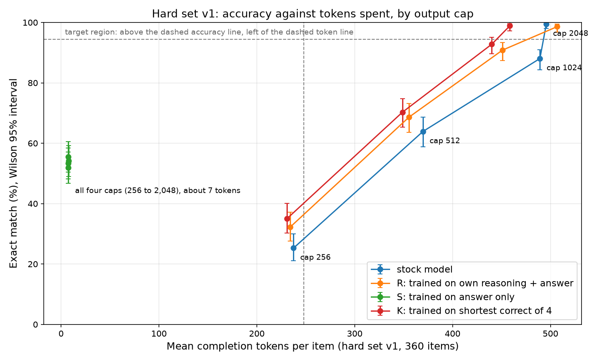
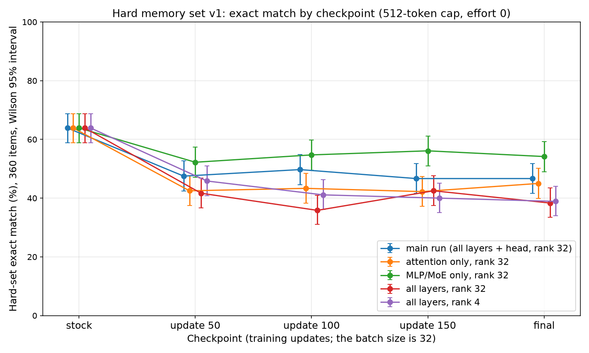

# Tinker memory-skills LoRA: results

Study 5. One templated memory curriculum, `thinkingmachines/Inkling-2-Mini`, LoRA through Tinker, one seed per arm. Updated 2026-11-25 with a hard held-out set. Terms: **update** = one optimizer step on a batch of 32 training rows (169 per run); **final** = after update 169; **arm** = one training run with one choice of adapter target and rank; **exact match** = the answer equals the expected string after case and punctuation folding, with a clean stop and no tool call; **Wilson interval** = 95% confidence interval for a proportion; **paired bootstrap** = resampling the 360 hard items 10,000 times (seed 0) and taking the 2.5 and 97.5 percentiles of the accuracy difference between two arms on the same items; **rank** = LoRA adapter size (4 or 32 here); **cap** = maximum tokens the model may generate per answer. **K** = adapter trained on the shortest correct reasoning trace out of four samples per item; **trace** = the model's thinking text plus its answer.

## Conclusions, in the order things happened

1. **The easy test was saturated, and that is a finding about the benchmark.** All four LoRA grid arms and the main run reach 99.7 to 100% on the 300-row synthetic validation split by update 50 (untrained: 61 to 65%). The loss audit found no masking error; the targets are two to four content tokens from repeated templates. That split could not rank LoRA settings.
2. **On a harder set, answer-only tuning removed the reasoning, and effort did not bring it back.** Hard set v1 (360 items: long histories, distractors, three or four revisions per fact, joins, date arithmetic, abstention) is solvable: the untrained model scores 25.3%, 63.9%, 88.1% and 99.4% at output caps of 256, 512, 1,024 and 2,048 tokens, spending about 496 tokens per item at 2,048. Every earlier adapter answers in 7 to 8 tokens and scores 38 to 54% at the 512 cap, at or below stock, and the main and MLP-only adapters still answer in 7 to 8 tokens at thinking effort 0.5 and 0.9 with a 2,048 cap (45 to 56%). On date gaps they fall back to "17 days", the constant gap in the old training data (32 of 60 answers for the main adapter).
3. **Training on the model's own verified reasoning preserved accuracy at the same token cost.** R (1,414 items, own traces at natural length) scores 98.6% at 2,048 against stock's 99.4%, with 507 tokens per item against 496, and is 2.8 to 6.9 points above stock at the tighter caps. The control S (same items, answer text only) scores 52 to 56% at every cap: R minus S is +45.3 points at 2,048 (95% interval +40.0 to +50.6). Target content, not only target length, decides whether the model keeps reasoning.
4. **Selecting short traces made the reasoning a little shorter, not half as long.** K (shortest correct of four samples per item) scores 98.9% at 2,048 with 459 tokens: -48 tokens against R (interval -79 to -19), accuracy +0.3 points (interval -1.4 to +1.9). Its model follows its training targets' length (550 tokens against R's 630). The preregistered criterion, 94.4% accuracy with at most 248 tokens, is met by no model at any cap: the cheap settings are inaccurate (K at 256: 35.0%) and the accurate ones are not cheap. Four draws raised the share of items with a usable trace from 79.3% to 89.4% (join 47.0% to 70.3%, date_interval 42.0% to 66.3%), and the number of wrong clean answers did not rise (3 against R's 2 at 2,048).
5. **What the recipe is.** It is a worked example of how the content and length of training targets shape a reasoning model's behaviour on a synthetic memory task. It is not a recipe that makes the model better at memory: no adapter beat the untrained model at 2,048 tokens, and the easy-test gains from the first run were an artefact of a saturated benchmark.

## Summary

| Model | Training targets | Hard v1, cap 512 | Hard v1, cap 2,048 | Mean tokens at 2,048 | Original 300-item test, cap 2,048 |
| --- | --- | ---: | ---: | ---: | ---: |
| Stock | none | 63.9% | 99.4% | 496 | 63.0% |
| Main adapter | old curriculum, answer only | 46.7% | 47.8% (effort 0.9) | 7.7 | not run |
| MLP/MoE-only adapter | old curriculum, answer only | 54.2% | 56.4% (effort 0.9) | 7.7 | not run |
| S | v2 items, answer only | 55.6% | 53.3% | 7.5 | 52.0% |
| R | v2 items, own trace at natural length | 68.6% | 98.6% | 507 | 62.7% |
| K | v2 items, shortest of 4 correct traces | 70.3% | 98.9% | 459 | 69.7% |

The primary criterion (at least 94.4% with at most 247.9 mean tokens) is met by no model. The main and MLP-only rows are single runs from the first round; their 2,048-cap cell is at effort 0.9, where they were not run at effort 0.0. All rows: 360 items, temperature 1.0, one sample per item, one seed.



Each line has four points, left to right the 256, 512, 1,024 and 2,048-token caps (labelled on the stock line); S has four points at about 7 tokens. Bars are Wilson 95% intervals. The dashed lines mark the preregistered target: at least 94.4% exact match with at most 247.9 mean tokens.

## Spend (estimates from token counts at list prices; billing endpoint still empty)

| Phase | Estimated USD |
| --- | ---: |
| First round: main run, four grid arms, hard-set sampling (details below) | 39.84 |
| Reasoning follow-up: diagnostics, distillation, R, S (with the failed first S attempt), their evaluations | 18.72 |
| Shortest-of-k: three extra draws per item | 6.21 (3.71 if prefill is billed once per request) |
| K training (7.14M tokens) and in-run sampling | 5.36 + 0.20 |
| K evaluations (hard v1, synthetic check) | 0.99 + 0.10 |
| **Whole task** | **71.4** (about 68.9 on the lower extra-sampling estimate) |

The K experiment cost $12.9 against its $20 budget; the task stays under the $85 cap. Not included: final likelihood passes and checkpoint storage.

## Limits

- One seed per arm, one learning rate, one task family. Differences of a few points between R, K and stock at one cap are within what another seed could change; the interval widths treat items as independent draws and understate uncertainty.
- Synthetic, templated data in training and test; hard v1 and the v2 training world come from one generator (entities, codes, wording, dates and seeds disjoint, item kinds shared). This is in-distribution held-out data, not LongMemEval or LoCoMo, and says nothing about natural memory tasks.
- The stock model is the ceiling here: the training targets are its own successes within 2,048 tokens, so no adapter can learn to answer what stock cannot, and the hardest kinds (join, date_interval) were under-represented for R.
- K and R differ in their items (more long items in K) as well as in trace length, so K minus R mixes the two.
- The selection could favour lucky guesses; the error counts above show no increase, but they are 3 against 2 clean wrong answers out of 360.
- All training and scoring at effort 0.0 except the diagnostic effort runs; the reader check (12 items) means nothing.
- Hard v1 was built after the saturation finding; the "17 days" explanation rests on counts of answers in transcripts, not on probing the weights.

## Reproduction

Commands for the first round are in the detail section below. For the follow-up (paths as in the earlier sections):

```bash
cd $COOKBOOK_DIR   # branch recipe-agent-memory
D=$SCRATCH_DIR/reasoning-v2
distill generate --count 1800 --out $D/candidates.jsonl          # python -m tinker_cookbook.recipes.agent_memory.distill ...
distill sample --data $D/candidates.jsonl --out $D/samples        # draw 0, 1 sample per item, key from the environment
distill sample-extra --data $D/candidates.jsonl --out $D/samples-extra --extra 3
distill select --data $D/candidates.jsonl --samples $D/samples --extra-samples $D/samples-extra --out $D/selected
distill build --data $D/candidates.jsonl --selected $D/selected/selected.jsonl --out $D/curriculum-K --count 1414 --subsample-seed 0
distill build --data $D/candidates.jsonl --samples $D/samples --out $D/curriculum --count 1414   # R and S
# train each arm with train.py (dry_run=True first), then score with hard_eval.py batch, synthetic_check.py, and
reasoning_report --results research/tinker/hard/v1 --png research/tinker/hard/reasoning-curves.png
```

The sampled responses are stored in `reasoning-v2/samples.jsonl.gz` and `reasoning-v2/samples-extra.jsonl.gz`; reports in `reasoning-v2/*.json`.

## Checkpoints that remain on the account

Sampler checkpoints (LoRA weights usable for sampling, 0.08 to 1.5 GB): main run at updates 50, 100, 150 and final; grid arms attn-r32, mlp-r32, all-r32 and all-r4 at updates 50, 100, 150 and final; R at update 50 and final; S (retry) final; K final. Training-state checkpoints (4.4 GB each for rank 32, kept only for resuming): final of the main run, of each of the four grid arms, of R, S (retry) and K, plus R's update 50. A further set of 6 checkpoints (`<run>`: sampler and training state at updates 50, 100 and final, 17.4 GB) belongs to the trained-tools run of another task and was not touched. K saved only its final checkpoint, so no intermediate K state needed deleting. The account listing shows 39 checkpoints, 73.3 GB, against a storage limit that stopped one run earlier. The training-state copies of the finished runs (about 30 GB) are the first thing to delete if storage is needed.


## Detail: conclusions of the reasoning-targets follow-up (R and S)

Preregistered in `PREREG-reasoning.md` before any sampling for parts 2 and 3; Part 1 is descriptive. Terms added: **R** = adapter trained on the model's own verified reasoning plus its answer; **S** = adapter trained on the same items with the final answer text only; **self-distillation** = training on the untrained model's own outputs that were checked against the answer key; **completion tokens** = tokens the model generated per item, thinking included.

1. **The preregistered primary question is answered no.** R did not reach stock's 2,048-cap accuracy minus 5 points with at most half of stock's completion tokens. At the 2,048-token cap R scores 98.6% (355/360; stock 99.4%) but spends 507 tokens per item, against stock's 496. At the 256-token cap R spends 234 tokens (inside the 248-token limit) and scores 32.2%. No cap meets both conditions.
2. **R keeps the reasoning; S loses it.** The paired difference R minus S is +45.3 points at 2,048 (95% interval +40.0 to +50.6), +36.7 at 1,024 and +13.1 at 512. S answers in about 7 tokens at every cap and scores 52 to 56% regardless of cap. Only at a 256-token cap does S beat both, because stock and R are cut off mid-thought there (S minus R: +19.7 points).
3. **R is about as good as stock and slightly better at tight caps, not cheaper.** R minus stock is +6.9 (+2.5 to +11.4) at 256, +4.7 (+1.1 to +8.6) at 512, +2.8 (-0.3 to +6.1) at 1,024 and -0.8 (-2.2 to +0.3) at 2,048, with mean completion tokens within 10% of stock at each cap (234 vs 238, 355 vs 370, 451 vs 489, 507 vs 496). That is a small gain from training on the model's own successful traces at tight caps. It is not a compression of the reasoning.
4. **Earlier adapters did not reason again when given the chance.** The main adapter and the MLP-only adapter, run at effort 0.5 and 0.9 (default) with a 2,048 cap, still answered in 7 to 8 tokens and scored 45 to 48% and 50 to 56%: the shortcut is in the weights, not in the effort setting.
5. **Where the keep rate was low, by design of the cap.** Self-distillation kept 1,427 of 1,800 candidates (79.3%). Two kinds were kept under 50%: `join` 47.0% and `date_interval` 42.0%; nearly all losses there were answers cut off at 2,048 tokens, not wrong answers. After a length filter the training set was 1,414 items: 291 revision, 293 historical, 299 date_order, 277 missing, 128 join and 126 date_interval. The training data therefore under-represent exactly the hardest kinds, and R's weakest hard-set kinds are join (93% at 2,048) and the 1,024-cap date_interval (57%).
6. **Regression check on the old tasks (cap 2,048, effort 0.0):** original 300-item synthetic test: stock 63.0%, R 62.7%, S 52.0%. S lost the memory tool-call skills (tool_write 0%, tool_read 26%, against stock 16% and 68%); R held them near stock (24%, 52%). The 12-item reader check: stock 12/12, R 9/12, S 9/12, too few items to read anything into it. Neither new curriculum contains tool-call examples, so tool-call scores say little beyond forgetting.

This is one seed per arm on synthetic data, scored on a set that now shares a generator with the training data (entities, codes, wording, dates and seeds disjoint; item kinds not). Treat it as an in-distribution held-out result.

## Detail: conclusions of the first round (hard set v1, LoRA target and rank grid)

> **Pre-registration timing, stated plainly.**
> - `PREREG-lora.md` (the LoRA target and rank grid) was written before the five grid runs were launched (launch time in `LEDGER.md`: 2026-11-25 10:40:58 UTC; the file's SHA-256 is recorded there at that time). It was **not committed before the runs**. Its first commit (79a4a1e5, 07:47:53 -0600) is the same commit that added the grid results, about three hours after launch. Unlike the other pre-registrations in this folder, it therefore cannot be verified from commit history, and the SHA-256 in the ledger was recorded in a file committed in that same commit. Treat it as self-attested. This study treats the grid as descriptive for that reason.
> - Hard-set sampling began **before the code that generates and scores the hard set was committed**. `AMENDMENT-hard-set.md` was committed at 05:17:23 -0600, the first hard-set sampling output is stamped 05:17:35, and `hard_eval.py` was first committed at 05:18:56 (cookbook commit 57002b2), 81 seconds after that output. The data file `hard/v1.jsonl` (generated 05:16:55) regenerates byte-identically from the committed code, and every stored score was recomputed independently from the transcripts, so the numbers stand. The claim that the hard-set code was committed before sampling does not hold. The arm K training also ran on code that was uncommitted at the time; its diff was saved with the run.

1. **The original synthetic test is saturated, and that is a finding about the benchmark, not a win for the adapter.** Every trained arm reaches 99.7 to 100% on the 300-row validation split by update 50 (untrained 61 to 65% across arms). The loss audit found no masking bug: targets are two to four content tokens and the templates repeat across 5,400 rows. That split cannot rank LoRA settings, so the registered comparison could not be answered with it.
2. **On a harder held-out set, no trained arm beats the untrained model at the matched protocol.** Hard set v1 (360 items: longer histories, distractors, three or four revisions per fact, joins, date arithmetic, abstention) scores stock at 63.9% and the trained arms at 38 to 54% at the final checkpoint, all below stock, with a 512-token cap and effort 0.0 for every model. All adapters stop cleanly on every item (parse-clean 100%); stock stops cleanly on 64%.
3. **What the adapters lost is multi-step reasoning; what they kept is the training templates.** With a 2,048-token cap the stock model scores 99.4% (358/360), so the items are solvable. At 512 tokens the stock model reasons in its thinking text and is cut off on 36% of items. The adapters answer immediately. On the 60 date-interval questions they answer "17 days" 32 times (main run), 27 (all layers, rank 32), 24 (all layers, rank 4), 10 (MLP only) and 9 (attention only), and 17 days is the constant gap in the training histories. They learned the answer format and its common values, not date arithmetic. Because the set is scored at the cap and effort used in training, it measures answering without room to reason, not memory ability in general.
4. **Target and rank comparisons (descriptive, one seed, final checkpoint).** MLP/MoE-only rank 32 is highest at 54.2%, attention-only rank 32 is 45.0%, all layers rank 32 is 38.3%, all layers rank 4 is 38.9%. Paired bootstrap intervals exclude zero for MLP-only minus all-layers, attention-only minus all-layers (lower end +0.8 points, barely) and attention-only minus MLP-only; rank 4 minus rank 32 includes zero. These are single runs on one task, and each arm moves by several points between neighbouring checkpoints (all layers rank 32 reads 35.8% at update 100 and 42.5% at update 150), so intervals that treat items as the only source of noise understate the run-to-run spread. This is not evidence that MLP-only is generally better.
5. **The 12-item reader check** is too small to mean anything; it stays in Appendix A and is not used here.

## Detail: hard set v1, what it is and how it was added

Added post hoc after the saturation finding; see `AMENDMENT-hard-set.md` (the addendum was committed before hard-set sampling, but the generator and scorer code were committed 81 seconds after the first sampling output; see the timing note at the top of the first-round conclusions; PREREG-lora.md is unchanged). `hard_eval.py` generates it from a seed under CC0: 360 items, 60 per question kind, 80 dated notes and 8 distractor people per item, prompts of 3,082 to 3,855 tokens (training histories are about 1.7K), notes in date order at this level. Names, offices, system prompt and sentence templates are disjoint from training (a test checks the vocabulary against the full training corpus). Two independent answer paths agree on every item at all three difficulty levels: the generator's oracle, and a solver that re-reads only the rendered text.

Difficulty rule, fixed in advance: move to a harder level if the main adapter scores above 95% or stock above 90%, both at the 512-token cap. Level 1 gave stock 63.9% and the main adapter's final checkpoint 46.7%. Neither trips the rule, so level 1 is the only version scored; levels 2 and 3 exist in code and were never sampled. A first draft with 13K-token prompts exceeded the recipe length and was discarded before any sampling. The 2,048-token stock run is a supplementary check added after seeing stock's truncation; it did not change which set was used.

### Learning curve per arm (exact match, Wilson 95% interval in parentheses, n = 360)

Stock model: 63.9% (58.8 to 68.7), parse-clean 64%.

| Arm | Update 50 | Update 100 | Update 150 | Final (169) |
| --- | ---: | ---: | ---: | ---: |
| Main run (all layers and output head, rank 32) | 47.5% (42 to 53) | 49.7% (45 to 55) | 46.7% (42 to 52) | 46.7% (42 to 52) |
| Attention only, rank 32 | 42.5% (37 to 48) | 43.3% (38 to 48) | 42.2% (37 to 47) | 45.0% (40 to 50) |
| MLP/MoE only, rank 32 | 52.2% (47 to 57) | 54.7% (50 to 60) | 56.1% (51 to 61) | 54.2% (49 to 59) |
| All layers, rank 32 | 41.7% (37 to 47) | 35.8% (31 to 41) | 42.5% (37 to 48) | 38.3% (33 to 43) |
| All layers, rank 4 | 45.8% (41 to 51) | 41.1% (36 to 46) | 40.0% (35 to 45) | 38.9% (34 to 44) |



### Per-kind breakdown at the final checkpoint

`revision`: current value after revisions. `historical`: value on a date between two revisions. `join`: current office of the current mentor (two hops). `date_order`: whose current review date is earlier. `date_interval`: days from the current filing deadline to the current review date, as "N days". `missing`: fact never recorded, correct answer "Not stated".

| Checkpoint | revision | historical | join | date_order | date_interval | missing |
| --- | ---: | ---: | ---: | ---: | ---: | ---: |
| Stock (512-token cap) | 97% | 97% | 27% | 75% | 0% | 88% |
| Stock (2,048-token cap, supplementary) | 100% | 100% | 98% | 100% | 98% | 100% |
| Main run (all layers and output head, rank 32), final | 88% | 33% | 20% | 73% | 2% | 63% |
| Attention only, rank 32, final | 90% | 12% | 28% | 60% | 3% | 77% |
| MLP/MoE only, rank 32, final | 97% | 58% | 32% | 83% | 2% | 53% |
| All layers, rank 32, final | 65% | 35% | 10% | 62% | 0% | 58% |
| All layers, rank 4, final | 63% | 35% | 22% | 58% | 0% | 55% |

### Paired bootstrap differences (final checkpoint, 10,000 draws, seed 0)

| Difference at the final checkpoint | Accuracy difference | 95% paired-bootstrap interval |
| --- | ---: | ---: |
| attn-r32 minus all-r32 | +6.7 points | +0.8 to +12.5 |
| mlp-r32 minus all-r32 | +15.8 points | +11.1 to +20.8 |
| all-r4 minus all-r32 | +0.6 points | -3.9 to +5.0 |
| attn-r32 minus mlp-r32 | -9.2 points | -14.7 to -3.6 |

## Detail: spend of the first round

Estimates from token counts at list prices ($0.75/M train, $0.15/M prefill, $0.50/M sampling). Tinker's billing endpoint was still empty when checked, so none of this is an invoice.

| Item | Estimated USD |
| --- | ---: |
| Main run, training | 6.70 |
| Main run, in-run sampling | 0.49 |
| Four grid arms, training (4 × 6.704) | 26.82 |
| Four grid arms, in-run sampling (4 × about 0.41) | 1.64 |
| Hard-set sampling, 23 evaluations (22 at 512 tokens, one supplementary at 2,048) | 4.19 |
| **Total estimated** | **39.84** |

Not included: final validation likelihood passes (conservative allowance about $0.62 each, five runs) and checkpoint storage ($0.10/GB/month). Even with those the total is under $45 against the $85 cap. Rank 128 was rejected by the service (maximum rank 64) before any compute and was not retried or replaced. Per-evaluation numbers are in COST.md and `hard/v1/*/metrics.json`.

## Detail: reproduction of the first round

```bash
cd $COOKBOOK_DIR   # branch recipe-agent-memory
R=$STUDY_DIR
# regenerate the set (byte-identical; sha256 in hard/preflight-v1.json) and dry-run its cost
.venv/bin/python -m tinker_cookbook.recipes.agent_memory.hard_eval generate --data $R/hard/v1.jsonl --level 1
.venv/bin/python -m tinker_cookbook.recipes.agent_memory.hard_eval preflight --data $R/hard/v1.jsonl
# score checkpoints; plan.json is a list of {"name": ..., "checkpoint": ...} built from each run's checkpoints.jsonl
# ("stock" as the checkpoint scores the untrained model); the key comes from the environment
TINKER_API_KEY=... .venv/bin/python -m tinker_cookbook.recipes.agent_memory.hard_eval batch \
  --data $R/hard/v1.jsonl --plan plan.json --output $R/hard/v1
# the supplementary 2,048-token stock run: add --max-tokens 2048 with a plan holding only the stock entry
.venv/bin/python -m tinker_cookbook.recipes.agent_memory.hard_report --results $R/hard/v1 --png $R/hard/hard-v1-curves.png
.venv/bin/python -m pytest tinker_cookbook/recipes/agent_memory/
```

Raw per-item records: `hard/v1/<arm>-<update>/transcripts.jsonl`. Metrics and the checkpoint path per evaluation: `hard/v1/<arm>-<update>/metrics.json`. All intervals and differences: `hard/v1/hard-report.json`. The set itself (`hard/v1.jsonl`, 5.3 MB) is git-ignored and regenerated with the first command.

## Detail: limits of the first round

- One seed per arm, one learning rate, one task family. Several differences between arms are about the size of the checkpoint-to-checkpoint wobble inside a single arm.
- Synthetic, templated data in training and in the hard set. Items share templates, so the 360 items are not independent draws from a natural distribution and the Wilson and bootstrap intervals are optimistic. This is not LongMemEval or LoCoMo.
- The hard set was built after seeing saturation. The stock-versus-adapter gap depends on the 512-token cap and effort 0.0 inherited from training; at a 2,048-token cap stock is near 100%. Adapters were not scored at a larger cap and were not trained on reasoning traces; whether that would help is untested.
- The 12-item reader check is too small to mean anything.
- Rank is capped at 64 by the service, so rank 128 from the registered grid was never run.
- One sample per item per checkpoint at temperature 1.0.
- Adapters were not merged or run locally.

## Detail: reasoning-targets follow-up (parts 1 to 3)

### Part 1: diagnostics on hard v1 (descriptive, existing checkpoints)

Stock accuracy against output cap at effort 0.0, 360 items (Wilson interval in parentheses, mean completion tokens):

| Cap | Exact match | Mean completion tokens |
| ---: | ---: | ---: |
| 256 | 25.3% (21.1 to 30.0) | 237.5 |
| 512 | 63.9% (58.8 to 68.7) | 369.7 |
| 1,024 | 88.1% (84.3 to 91.0) | 489.3 |
| 2,048 | 99.4% (98.0 to 99.8) | 495.8 |

Mean tokens flatten once most items finish (about 490 to 496); the cap mainly decides how many items are cut off.

Effort options: the renderer takes any number in [0, 1) as the thinking-effort directive, default 0.9; training and all earlier sampling used 0.0. The adapters were run at 0.5 and 0.9 with a 2,048 cap:

| Adapter (final checkpoint) | Effort | Exact match | Mean completion tokens | "17 days" on the 60 date-interval items |
| --- | ---: | ---: | ---: | ---: |
| Main run | 0.0 (cap 512) | 46.7% | 7.5 | 32 |
| Main run | 0.5 | 45.3% | 7.5 | 33 |
| Main run | 0.9 | 47.8% | 7.7 | 24 |
| MLP/MoE only, rank 32 | 0.0 (cap 512) | 54.2% | 7.5 | 10 |
| MLP/MoE only, rank 32 | 0.5 | 50.3% | 8.2 | 13 |
| MLP/MoE only, rank 32 | 0.9 | 56.4% | 7.7 | 12 |

Neither adapter produced a thinking block at 0.9; one MLP-only item did at 0.5. The "17 days" default is still there.

### Part 2: the v2 curriculum

Generator: `hard_eval.py` kinds in its second world (`TRAIN`: own names, codes, sentence templates, questions, system prompt, base year 2063, note spacing 2 to 6 days, archive length varied). Tests check zero overlap with hard v1 (names, codes, values, templates, questions, prompts, system prompt) and with the original persona corpus vocabulary. Date gaps now vary across items: 12 or more distinct answers in a 120-item sample, none above 3 copies. Stock sampled at effort 0.0, 2,048 cap, temperature 1.0 on 1,800 candidates (600 per level, 300 per kind); kept responses stop cleanly with one thinking part and one text part and a correct final answer.

| Kind | Sampled | Kept | Keep rate | Cut off or malformed | Wrong answer |
| --- | ---: | ---: | ---: | ---: | ---: |
| revision | 300 | 291 | 97.0% | 3 | 6 |
| historical | 300 | 293 | 97.7% | 2 | 5 |
| join | 300 | 141 | **47.0%** | 142 | 17 |
| date_order | 300 | 299 | 99.7% | 1 | 0 |
| date_interval | 300 | 126 | **42.0%** | 154 | 20 |
| missing | 300 | 277 | 92.3% | 23 | 0 |

By level: 85.5%, 79.5%, 72.8% kept. Fewer than the planned 1,500 survived, so the preregistered rule applied: all usable items, 1,414 after dropping 13 whose sequence exceeded 8,000 tokens, mean 630 completion tokens per kept target. R and S use the same items. Both arms: rank 32, all attention and MLP/MoE layers plus head as in the main run, learning rate 0.00054, one epoch, batch 16 (89 updates), effort 0.0, seed 0. Training tokens 7,234,265 (R) and 6,353,190 (S). Final in-run held-out numbers on the training world (48 items, 2,048 cap): R valid 89.6%, test 79.2%; S valid 39.6%, test 39.6%.

Operational issue: the first S run failed at its update-50 checkpoint save with "free checkpoint storage limit reached", after about $2.74 of training. I deleted 15 intermediate training-state checkpoints (updates 50, 100, 150) of the main run and the four grid arms, and the failed run's two checkpoints, all listed in the runs' `checkpoints.jsonl`; their sampler weights remain. S was then rerun from scratch with identical settings, new log path `runs/reason-S-s0-retry`, saving only the final checkpoint. The failed run's partial logs stay in `runs/reason-S-s0`. S's hard-set results use the rerun.

### Part 3: evaluation on hard v1 (preregistered)

Exact match (Wilson 95% interval) and mean completion tokens, 360 items, effort 0.0, temperature 1.0, one sample per item:

| Model | Cap 256 | Cap 512 | Cap 1,024 | Cap 2,048 |
| --- | ---: | ---: | ---: | ---: |
| Stock | 25.3% (21 to 30), 238 tok | 63.9% (59 to 69), 370 tok | 88.1% (84 to 91), 489 tok | 99.4% (98 to 100), 496 tok |
| R (reasoning targets) | 32.2% (28 to 37), 234 tok | 68.6% (64 to 73), 355 tok | 90.8% (87 to 93), 451 tok | 98.6% (97 to 99), 507 tok |
| S (answer-only targets) | 51.9% (47 to 57), 7 tok | 55.6% (50 to 61), 7 tok | 54.2% (49 to 59), 8 tok | 53.3% (48 to 58), 7 tok |


Paired bootstrap differences, accuracy points (95% interval, 10,000 draws, seed 0):

| Comparison | Cap 256 | Cap 512 | Cap 1,024 | Cap 2,048 |
| --- | ---: | ---: | ---: | ---: |
| R minus S | -19.7 (-25.8 to -13.6) | +13.1 (+7.8 to +18.1) | +36.7 (+31.4 to +41.9) | +45.3 (+40.0 to +50.6) |
| R minus stock | +6.9 (+2.5 to +11.4) | +4.7 (+1.1 to +8.6) | +2.8 (-0.3 to +6.1) | -0.8 (-2.2 to +0.3) |
| S minus stock | +26.7 (+20.6 to +32.8) | -8.3 (-13.9 to -2.8) | -33.9 (-39.2 to -28.6) | -46.1 (-51.4 to -40.8) |

Per-kind exact match at the 2,048 cap: stock revision 100, historical 100, join 98, date_order 100, date_interval 98, missing 100; R 100, 100, 93, 100, 98, 100; S 92, 48, 35, 70, 0, 75. S never writes "17 days" here (1 item at the 512 cap), so its date-gap answers are wrong in other ways: it no longer has the training template to fall back on.

Original synthetic test (300 items) and 12-item reader check at 2,048 cap, effort 0.0:

| Model | Test | recall | update | abstain | temporal | tool_write | tool_read | Reader check |
| --- | ---: | ---: | ---: | ---: | ---: | ---: | ---: | ---: |
| Stock | 63.0% | 92 | 90 | 94 | 18 | 16 | 68 | 12/12 |
| R | 62.7% | 94 | 82 | 100 | 24 | 24 | 52 | 9/12 |
| S | 52.0% | 88 | 96 | 100 | 2 | 0 | 26 | 9/12 |

### Part 4: shortest-of-k (arm K), preregistered in `PREREG-shortest.md`

K uses the same 1,800 candidate items and world as R. Each item got four stock samples (R's pool is draw 0, three new draws at temperature 1.0, 2,048 cap, effort 0.0); the shortest usable sample is the target. Usable samples are chosen by the same rule as R.

| Kind | First draw usable (R's rate) | At least one of 4 usable | Mean kept tokens | Mean of all usable tokens | Kept / mean usable |
| --- | ---: | ---: | ---: | ---: | ---: |
| revision | 97.0% | 99.7% | 308 | 422 | 0.75 |
| historical | 97.7% | 100.0% | 314 | 415 | 0.77 |
| join | 47.0% | 70.3% | 1006 | 1215 | 0.81 |
| date_order | 99.7% | 100.0% | 545 | 669 | 0.82 |
| date_interval | 42.0% | 66.3% | 1285 | 1454 | 0.88 |
| missing | 92.3% | 100.0% | 334 | 527 | 0.65 |
| all | 79.3% | 89.4% | 571 | 718 | |

Four draws lifted the share of items with a usable trace from 79.3% to 89.4%: `join` from 47.0% to 70.3% and `date_interval` from 42.0% to 66.3%. No kind is now under 50%. Selection removed 12 to 35% of the length against the average usable trace of the same item. By how many of the four draws were usable (where selecting the shortest could pick a lucky guess):

| Usable draws out of 4 | Items | Mean kept tokens |
| ---: | ---: | ---: |
| 1 | 102 | 1559 |
| 2 | 98 | 1088 |
| 3 | 194 | 745 |
| 4 | 1215 | 418 |

Kept traces under 100 tokens: 7 of 1,609. Items solved by only one draw in four (102) are the ones with the long kept traces (mean 1,559 tokens), not short ones, so selection did not mostly reward short guesses.

Training set: 1,579 usable items under the 8,000-token sequence limit, 1,414 drawn with `random.Random(0)` (R's count). Mean target length 550 tokens, against 630 for R. Kind mix (K against R): revision 264/291, historical 275/293, date_order 263/299, missing 267/277, join 170/128, date_interval 175/126. K's items therefore differ from R's: more of the long kinds, a different subset. K trained with R's settings (89 updates, 7,143,766 tokens, $5.36), final checkpoint only; in-run held-out on the training world: valid 87.5%, test 89.6%.

Hard v1, exact match (Wilson 95% interval) and mean completion tokens:

| Model | Cap 256 | Cap 512 | Cap 1,024 | Cap 2,048 |
| --- | ---: | ---: | ---: | ---: |
| Stock | 25.3% (21 to 30), 238 tok | 63.9% (59 to 69), 370 tok | 88.1% (84 to 91), 489 tok | 99.4% (98 to 100), 496 tok |
| R (own traces, natural length) | 32.2% (28 to 37), 234 tok | 68.6% (64 to 73), 355 tok | 90.8% (87 to 93), 451 tok | 98.6% (97 to 99), 507 tok |
| S (answer only) | 51.9% (47 to 57), 7 tok | 55.6% (50 to 61), 7 tok | 54.2% (49 to 59), 8 tok | 53.3% (48 to 58), 7 tok |
| K (shortest correct of 4) | 35.0% (30 to 40), 231 tok | 70.3% (65 to 75), 349 tok | 92.8% (90 to 95), 440 tok | 98.9% (97 to 100), 459 tok |


Paired bootstrap, 10,000 draws, seed 0 (difference, 95% interval):

| Comparison | Cap 256 | Cap 512 | Cap 1,024 | Cap 2,048 |
| --- | ---: | ---: | ---: | ---: |
| K minus R, accuracy points | +2.8 (-1.1 to +6.7) | +1.7 (-1.7 to +5.0) | +1.9 (-1.1 to +5.0) | +0.3 (-1.4 to +1.9) |
| K minus R, mean completion tokens | -3.3 (-6.7 to -0.1) | -6.6 (-14.3 to +0.8) | -11.0 (-26.6 to +4.6) | -48.3 (-78.7 to -19.0) |
| K minus stock, accuracy points | +9.7 (+5.8 to +13.6) | +6.4 (+2.8 to +10.3) | +4.7 (+1.7 to +7.8) | -0.6 (-1.7 to +0.6) |
| K minus stock, mean completion tokens | -6.8 (-10.3 to -3.2) | -20.9 (-28.5 to -13.6) | -49.2 (-67.3 to -31.6) | -37.2 (-60.9 to -14.3) |

Preregistered primary criterion for K (at least 94.4% with at most 247.9 mean tokens): not met at any cap. At 2,048 tokens K has the accuracy (98.9%, 356/360) and 459 tokens; at 256 it has the tokens (231) and scores 35.0%. The ratio of K's to R's tokens at 2,048 is 0.91, close to the ratio of their training targets (550 to 630 is 0.87): the model's trace length followed the target length, by a small amount.

Per-kind exact match at the 2,048 cap, with the error mix. K: revision 100, historical 100, join 95, date_order 100, date_interval 98, missing 100; 4 misses, of which 1 cut off and 3 clean wrong answers. R: 100, 100, 93, 100, 98, 100; 5 misses, 3 cut off and 2 wrong. At the 1,024 cap K has 26 misses (25 cut off, 1 wrong) against R's 33 (30 cut off, 3 wrong). K does not give more wrong answers than R, so there is no sign that selecting short traces taught guessing; the numbers are small. K's misses are mostly traces that run out of room, the same failure as stock's.

Original 300-item synthetic test at 2,048 cap and 12-item reader check: K 69.7% (recall 94, update 92, abstain 98, temporal 30, tool_write 32, tool_read 72; reader 11/12), against stock 63.0% and R 62.7%. No tool-call data were in K's training; the rise over stock is within the noise a one-seed comparison on this test allows and is not a claim.

### Spend for the follow-up (estimates from token counts at list prices; billing still empty)

| Item | Estimated USD |
| --- | ---: |
| Part 1: six evaluations | 1.23 |
| Distillation sampling, 1,800 candidates | 2.07 |
| R training (7.23M tokens) and in-run sampling | 5.43 + 0.21 |
| S first run, failed at update 50 (training and sampling) | 2.74 + 0.09 |
| S rerun (6.35M tokens) and in-run sampling | 4.77 + 0.15 |
| Hard-set evaluations, R (4) and S (4) | 1.01 + 0.73 |
| Synthetic-test and reader-check evaluations, stock, R, S | 0.29 |
| **Follow-up total** | **18.72** |

Against the $30 follow-up budget, and about $58.6 cumulative for the whole task against the $85 cap (earlier total $39.84). Not included: final likelihood passes and checkpoint storage.

### Reproduction (follow-up)

```bash
cd $COOKBOOK_DIR   # branch recipe-agent-memory
D=$SCRATCH_DIR/reasoning-v2
# candidates (deterministic) and a cost dry run, then the paid sampling (key from the environment)
.venv/bin/python -m tinker_cookbook.recipes.agent_memory.distill generate --count 1800 --out $D/candidates.jsonl
.venv/bin/python -m tinker_cookbook.recipes.agent_memory.distill sample --data $D/candidates.jsonl --out $D/samples
# the sampled responses of this study are in research/tinker/reasoning-v2/samples.jsonl.gz; build the R and S curricula from them
gunzip -c research/tinker/reasoning-v2/samples.jsonl.gz > samples.jsonl   # place it at $D/samples/samples.jsonl
.venv/bin/python -m tinker_cookbook.recipes.agent_memory.distill build --data $D/candidates.jsonl --samples $D/samples --out $D/curriculum --count 1414
# train each arm (dry_run=True first), e.g. R
.venv/bin/python -m tinker_cookbook.recipes.agent_memory.train data_path=$D/curriculum/R model_name=thinkingmachines/Inkling-2-Mini \
  batch_size=16 num_epochs=1 lora_rank=32 lora_seed=0 seed=0 effort=0.0 max_length=8192 max_tokens=2048 eval_every=50 save_every=1000 budget_usd=40 log_path=runs/reason-R-s0
# score with hard_eval.py batch (plan entries may set max_tokens and effort), synthetic_check.py, then the report
.venv/bin/python -m tinker_cookbook.recipes.agent_memory.reasoning_report --results research/tinker/hard/v1 --png research/tinker/hard/reasoning-curves.png
```

Raw outputs: `hard/v1/<name>/transcripts.jsonl` and `metrics.json` (names `stock-cap256`, `R-final-cap2048`, `main-final-e0.9-cap2048`, ...), `hard/synthetic/<name>/`, `hard/v1/reasoning-report.json`, `reasoning-v2/keep-report.json` and `manifest.json`. The 36 MB candidate file and the 20 MB curricula are not committed.

### Limits (follow-up)

- One seed per arm and one learning rate. R minus stock differences of a few points are within what a different seed could change.
- The training set is the model's own successes within 2,048 tokens: it under-represents the hardest items (join and date_interval kept at 47% and 42%) and teaches nothing the stock model could not already do. It cannot make the model reason beyond what it did when sampled.
- Hard v1 and the training worlds share a generator: this measures in-distribution held-out behaviour, not transfer to natural memory tasks or to LongMemEval or LoCoMo.
- The R-versus-stock comparison uses one sample per item at temperature 1.0; stock at 2,048 has a Wilson interval of 98.0 to 99.8%.
- Training and evaluation all ran at effort 0.0. Other effort settings were tried only on the earlier adapters.
- The first S run failed for an account storage limit and was rerun; its recorded cost includes the failed attempt.
- The reader-check differences (12 items) mean nothing.

## Appendix A: main run on the original synthetic split (unchanged, written before the hard set)

Completed 2026-11-25T10:34:09.716771+00:00. All 169 updates completed in 3077.538 seconds (51.29 minutes), including initial/periodic/final answer evaluation. Final validation NLL and adapter export were performed afterward. No training restart occurred.

| Metric | Initial (0 updates) | Final (169 updates) |
| --- | ---: | ---: |
| Validation exact match | 60.33% | 100.00% |
| Validation parse-clean | 94.67% | 100.00% |
| recall | 86.00% | 100.00% |
| update | 90.00% | 100.00% |
| abstain | 94.00% | 100.00% |
| temporal | 10.00% | 100.00% |
| tool_write | 6.00% | 100.00% |
| tool_read | 76.00% | 100.00% |
| Reader exact match | 75.00% | 58.33% |
| Reader parse-clean | 100.00% | 100.00% |
| Validation NLL | 2.81207418 | 3.85951324e-07 |

Final test exact match and parse-clean are both 100% (300 rows); each test skill is 100%. No initial test sampling was performed. The initial legacy `test/nll` key means validation NLL; final NLL is in `final_validation_nll.json`.

All curriculum skills and parsing improved. Reader exact match fell from 9/12 to 7/12. All five final misses state correct room facts with an extra `Room` prefix (`Room Cedar`/`Room Maple` versus `Cedar`/`Maple`); the three initial misses have the same pattern. This is exact-match wording sensitivity, not demonstrated factual forgetting. The fixed metric is retained unchanged; transcript inspection is not an independently validated semantic score.

This is the recipe's own held-out persona split with shared curriculum templates, not LongMemEval or LoCoMo. The 12-item original reader check is a smoke test. One run, an untuned LR and one data-order seed do not establish independent benchmark performance.

### Configuration and costs

Model `thinkingmachines/Inkling-2-Mini`, fresh post-trained base and fresh AdamW; rank 32, default adapter targets; batch 32; one epoch; LR 0.00054, linear decay; dataset-order seed 0; adapter initialization seed unspecified (SDK default); effort 0.0; max length 8192; output cap 512; temperature 1.0; eval/save 50; submit-ahead 0; budget_usd=40; no W&B. Train/valid/test: 5400/300/300, zero persona/prompt overlap.

Training tracker: **$6.704253** for 8,939,004 tokens. Logged answer-sampling estimate, ignoring cache savings: **$0.489901**. These are recipe estimates, not a provider bill; NLL scoring and storage are separate. Authenticated `billing-before.json` and `billing-after.json` contain no events yet: Tinker-reported billed cost is **unavailable**, not zero. Billing can lag several hours. Preflight compute estimate $10.121344, reservation $25.242688; extra final NLL has a conservative $0.624 allowance. The task-wide cap is now $90; no added funds.

### Artifacts

Run directory: `$STUDY_DIR/runs/main`. Scalars: `metrics.jsonl`; endpoint: `final_memory_metrics.json`; likelihood: `final_validation_nll.json`; checkpoints: `checkpoints.jsonl`; unit log/timing: `service.log`, `service-times.json`.

Transcript pairs (HTML alongside each JSONL):
- valid_memory, updates 0, 300 records: `$STUDY_DIR/runs/main/valid_memory-9b530329c71e4120a467a1696d7aef5b.jsonl`; `$STUDY_DIR/runs/main/valid_memory-9b530329c71e4120a467a1696d7aef5b.html`
- valid_memory, updates 50, 300 records: `$STUDY_DIR/runs/main/valid_memory-66815bf1db7b40f3bea02dfe1c4b10f4.jsonl`; `$STUDY_DIR/runs/main/valid_memory-66815bf1db7b40f3bea02dfe1c4b10f4.html`
- valid_memory, updates 100, 300 records: `$STUDY_DIR/runs/main/valid_memory-a7bd5f85341e4f9f99064853b361543b.jsonl`; `$STUDY_DIR/runs/main/valid_memory-a7bd5f85341e4f9f99064853b361543b.html`
- valid_memory, updates 150, 300 records: `$STUDY_DIR/runs/main/valid_memory-a28658b17195470d9713cfbd3b930ca2.jsonl`; `$STUDY_DIR/runs/main/valid_memory-a28658b17195470d9713cfbd3b930ca2.html`
- valid_memory, updates 169, 300 records: `$STUDY_DIR/runs/main/valid_memory-a842ff4a8b564a2cb4c066e9693492f4.jsonl`; `$STUDY_DIR/runs/main/valid_memory-a842ff4a8b564a2cb4c066e9693492f4.html`
- reader_check, updates 0, 12 records: `$STUDY_DIR/runs/main/reader_check-b7acf06633214a81b43caeb8be7c21b9.jsonl`; `$STUDY_DIR/runs/main/reader_check-b7acf06633214a81b43caeb8be7c21b9.html`
- reader_check, updates 50, 12 records: `$STUDY_DIR/runs/main/reader_check-671421b712ab412ca3157730e62f8786.jsonl`; `$STUDY_DIR/runs/main/reader_check-671421b712ab412ca3157730e62f8786.html`
- reader_check, updates 100, 12 records: `$STUDY_DIR/runs/main/reader_check-59736d33bf3a4d64b2529d382bd50cbe.jsonl`; `$STUDY_DIR/runs/main/reader_check-59736d33bf3a4d64b2529d382bd50cbe.html`
- reader_check, updates 150, 12 records: `$STUDY_DIR/runs/main/reader_check-dd86e04c05794bb8bfb47a0f445d2acb.jsonl`; `$STUDY_DIR/runs/main/reader_check-dd86e04c05794bb8bfb47a0f445d2acb.html`
- reader_check, updates 169, 12 records: `$STUDY_DIR/runs/main/reader_check-ca34aad7e42a4b6ea190e355a9bd2508.jsonl`; `$STUDY_DIR/runs/main/reader_check-ca34aad7e42a4b6ea190e355a9bd2508.html`
- test_memory, updates 169, 300 records: `$STUDY_DIR/runs/main/test_memory-de904889780e48b8a6e660a1b3e06025.jsonl`; `$STUDY_DIR/runs/main/test_memory-de904889780e48b8a6e660a1b3e06025.html`

All 1,860 sampled evaluations have JSONL and HTML transcripts.

### Weights and operational issues

Final adapter: `$SCRATCH_DIR/main-adapter/adapter_model.safetensors` and `adapter_config.json` (PEFT LoRA, rank 32, alpha 32, `target_modules=all-linear`). Safetensors size: 1,415.8 MiB. Source: `tinker://<run>/weights/final`. The SDK restored the training checkpoint, exported encrypted external weights, decrypted locally and removed the temporary export.

These are adapters, not a merged model. They can in principle be applied/merged into corresponding open Inkling weights, subject to verifying looped-layer/expert tensor mapping and NVFP4/MXFP8 compatibility. No merge or local inference was attempted; the workstation was untouched.

Training succeeded. The first post-run helper asserted `record.final`, but the checkpoint log marks the endpoint with `name=final` instead of that optional flag. Corrected the helper and reran successfully, reusing its completed NLL result; no training was repeated. Recipe tests: 18 passed; pre-commit passed. No push, PR or upstream comment.

### Loss-mask audit and benchmark saturation (follow-up)

The synthetic held-out split is saturated by update 50; this is a finding about the benchmark, not evidence of broad memory improvement. Original scores above are unchanged. Independent rendering of all 5,400 training rows confirms zero prompt loss, aligned next-token targets, positive answer weights and per-example weight sum 1. `num_loss_tokens=32` is the sum of mean-normalized weights for 32 examples, not 32 supervised token positions. Only the last assistant target is supervised; prior acknowledgements and prior lookup calls are masked.

Supervised positions/content tokens per target: recall 8/4, update 8/4, abstain 6/2, temporal 6/2, tool_write 68/64, tool_read 8–44/4–40 (mean 26/22). Four structural tokens are also supervised per target. Some natural-language answers really are only two tokens; this is a narrow, repeatedly templated task. Evidence and decoded target spans: `audit/loss-mask.json`; reproduction script `$SCRATCH_DIR/audit-loss.py`.

Raw train NLL values (not rounded display): {"0": 2.970381259918213, "50": 2.6885621991823427e-05, "100": 1.5560988231300144e-06, "150": 5.048430011811433e-07, "168": 2.6581008683024265e-07}. Final independent validation sampler NLL is 3.8595e-7. The mask covers content as well as control tokens, so accurate control-token prediction alone cannot explain this tiny mean: every example places at least one-third of its loss mass on content. Under nonnegative NLL, content-only mean NLL is bounded above by three times this mean. Validation/test exact-match transcripts independently confirm the template answers are reproduced. No logging/masking artifact was found; the benchmark itself is too easy to establish the LoRA target/rank claim.
