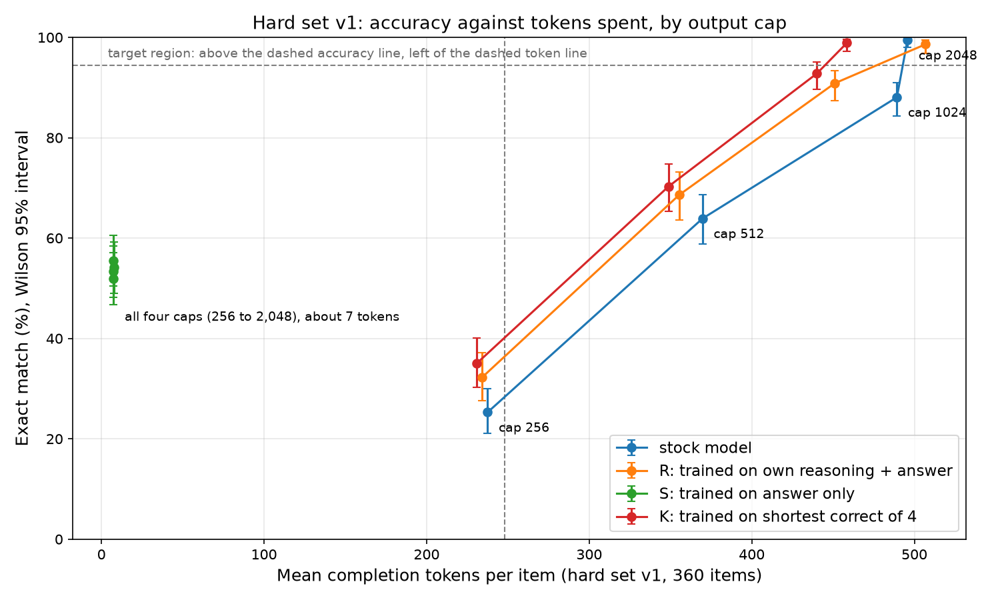

# Fine-tuning a reasoning model on short answers removed its reasoning; training on its own verified reasoning did not

## Conclusions

Everything below is one training run per setup (one seed), on synthetic data, with one model (`thinkingmachines/Inkling-2-Mini`), trained through the Tinker service with LoRA adapters.

1. The first test we used was too easy to tell training settings apart. Every adapter scored 99.7 to 100% on it after 50 updates, so the comparison we had planned (which layers to adapt, which rank) could not be answered with it.
2. On a harder test, adapters trained on short final answers did worse than the untrained model. They answered in 7 to 8 tokens, where the untrained model writes a reasoning trace of about 500 tokens first. Asking for more thinking effort at sampling time did not bring the reasoning back.
3. Training on the model's own reasoning, kept only when its final answer was correct, preserved accuracy: 98.6% against 99.4% for the untrained model with a 2,048-token output limit, at about the same number of tokens (507 against 496). Training on the same items with only the final answer (the control) scored 53.3%.
4. Choosing the shortest correct trace of four samples per item shortened the model's output by about 9% (459 tokens against 507) with no measured loss in accuracy (98.9%). We had pre-registered a target of at most half the tokens at nearly the same accuracy. No model met it.

None of the adapters beat the untrained model at a 2,048-token limit. This is a study of how the content of training targets changes a reasoning model's behaviour, not a method that improves memory.

## Terms used in this document

- **Update**: one optimizer step on a batch of 32 training rows.
- **LoRA adapter**: a small set of trained weights added to the frozen base model. **Rank** is the size of that adapter. **Target group**: which parts of the network get an adapter (attention layers, MLP/MoE layers, or all of them).
- **Output cap**: the maximum number of tokens the model may generate per item. The model reasons first and then answers, so a low cap cuts off the reasoning.
- **Exact match**: the model's final answer equals the expected string after lowercasing and keeping only word characters, and the model stopped cleanly without a tool call.
- **Stock**: the untrained model, `thinkingmachines/Inkling-2-Mini`.
- **Hard v1**: the 360-item hard test described below.
- **R**: an adapter trained on the model's own thinking plus its answer, using items where that answer was correct.
- **S**: an adapter trained on the same items as R with the final answer text only.
- **K**: an adapter trained on the shortest correct trace out of four samples per item.
- **Self-distillation**: training a model on its own outputs, here after checking them against the answer key.
- **Completion tokens**: tokens the model generated per item, thinking included.
- **Effort**: the renderer's thinking-effort setting (0.0, 0.5 or 0.9 here).
- **Wilson interval**: a 95% confidence interval for a proportion. Paired bootstrap intervals compare two arms on the same items (10,000 resamples).

## What was tried, in order

### 1. A memory curriculum and a saturated test

The first curriculum teaches dated-memory skills: recall, update, abstain when a fact is missing, simple date questions and two tool-call skills. Its histories are templated sessions built from persona sentences (CC BY 4.0 source; see `ATTRIBUTION.md`). Training data: 5,400 rows; validation and test: 300 rows each.

The plan was a small grid of adapter settings: attention only, MLP/MoE only, or both, at ranks 4 and 32, plus a main run. A rank 128 cell was requested, but the service rejected it (HTTP 400, maximum rank 64), so it was not run. Each run was 169 updates.

All runs reached 99.7 to 100% validation exact match by update 50, against 61 to 65% for the untrained model. A check of the loss masking found no error. The targets are two to four content tokens drawn from repeated templates, so the test could not rank the settings. We treat that as a finding about the test.

### 2. A harder test: answer-only tuning removed the reasoning

We then built Hard v1 (360 items, generated from a seed, CC0). Each item is about 3,000 to 3,900 tokens of dated desk notes about people, with distractor people, facts revised three or four times, and six question kinds (60 each): revision, historical value, join across two people, date order, date interval and missing fact. The question vocabulary, names, system prompt and sentence templates do not overlap with the training data.

The untrained model solves it if given room to reason:

| Output cap | Stock exact match | Mean completion tokens |
| ---: | ---: | ---: |
| 256 | 25.3% | 238 |
| 512 | 63.9% | 370 |
| 1,024 | 88.1% | 489 |
| 2,048 | 99.4% | 496 |

At a 512-token cap, every first-round adapter scored 38 to 54%, below the untrained model's 63.9%. They answered in 7 to 8 tokens and fell back on the training templates. On the 60 date-interval questions the main adapter answered "17 days" 32 times; 17 days was the constant gap in the old training data. Two of the adapters, run with a 2,048-token cap at thinking effort 0.5 and 0.9, still answered in 7 to 8 tokens and scored 45 to 56%. The shortcut was in the weights, not in the effort setting.

First-round arms at the final checkpoint, hard v1, 512-token cap, effort 0.0 (exact match, 360 items): MLP/MoE-only rank 32 54.2%, main run 46.7%, attention-only rank 32 45.0%, all layers rank 4 38.9%, all layers rank 32 38.3%. These are single runs and the ordering moves by several points between neighbouring checkpoints, so we read them as descriptive.

### 3. Training on the model's own verified reasoning kept accuracy

For the second curriculum we made a new synthetic world with the same question kinds and its own names, codes, wording, dates and note spacing. The untrained model answered 1,800 such items with a 2,048-token cap. We kept responses with one thinking part and a correct final answer: 1,427 of 1,800 (79.3%), 1,414 after dropping 13 that were too long to train on. From the same kept items we built two curricula: R (thinking plus answer) and S (answer only).

The keep rate was low for two kinds, join (47.0%) and date interval (42.0%), almost entirely because the answers were cut off at 2,048 tokens, not because they were wrong. Training data therefore under-represent the hardest kinds.

Hard v1, exact match and mean completion tokens (360 items):

| Model | Cap 256 | Cap 512 | Cap 1,024 | Cap 2,048 |
| --- | ---: | ---: | ---: | ---: |
| Stock | 25.3%, 238 tok | 63.9%, 370 tok | 88.1%, 489 tok | 99.4%, 496 tok |
| R | 32.2%, 234 tok | 68.6%, 355 tok | 90.8%, 451 tok | 98.6%, 507 tok |
| S | 51.9%, 7 tok | 55.6%, 7 tok | 54.2%, 8 tok | 53.3%, 7 tok |

R minus S at 2,048 is +45.3 points (95% paired interval +40.0 to +50.6). R minus stock is +6.9 points at 256, +4.7 at 512, +2.8 at 1,024 (interval -0.3 to +6.1) and -0.8 at 2,048 (interval -2.2 to +0.3). The gain at tight caps comes with about the same token cost; R does not compress the reasoning. S answers in about 7 tokens at every cap and scores 52 to 56% regardless of cap. Same items, same size, different targets: the content of the targets, not only their length, decides whether the model keeps reasoning.

The pre-registered question for this step was whether R could reach stock's accuracy minus 5 points using at most half of stock's tokens. It did not: no cap met both conditions.

On the original 300-item test at a 2,048 cap, stock scored 63.0%, R 62.7% and S 52.0%. S lost the tool-call skills that R kept near stock (tool_write 0% against R's 24% and stock's 16%; tool_read 26% against R's 52% and stock's 68%). Neither new curriculum contains tool-call examples, so this says little beyond forgetting.

### 4. Shortest of four shortened output by about 9%

K uses the same 1,800 items. Each got four samples (the first being R's) and the shortest usable one was the target. Four draws raised the share of items with a usable trace from 79.3% to 89.4% (join 47.0% to 70.3%, date interval 42.0% to 66.3%). The kept trace averaged 571 tokens against 718 for the average usable trace of the same item. 1,579 items were usable under the sequence limit; 1,414 were drawn at random to match R's size. Mean target length was 550 tokens against R's 630.

| Model | Cap 256 | Cap 512 | Cap 1,024 | Cap 2,048 |
| --- | ---: | ---: | ---: | ---: |
| R | 32.2%, 234 tok | 68.6%, 355 tok | 90.8%, 451 tok | 98.6%, 507 tok |
| K | 35.0%, 231 tok | 70.3%, 349 tok | 92.8%, 440 tok | 98.9%, 459 tok |

K minus R at 2,048: -48 completion tokens (interval -79 to -19) and +0.3 points of accuracy (interval -1.4 to +1.9). The pre-registered target (at least 94.4% exact match with at most 248 mean tokens) was met by no model at any cap: the cheap settings were inaccurate (K at a 256 cap: 35.0%) and the accurate ones were not cheap. The number of wrong, cleanly finished answers did not rise (3 for K against 2 for R at 2,048, out of 360). K and R differ in which items they trained on as well as in trace length, so the K minus R comparison mixes the two.

## Summary

| Model | Training targets | Hard v1, cap 512 | Hard v1, cap 2,048 | Mean tokens at 2,048 | Original 300-item test, cap 2,048 |
| --- | --- | ---: | ---: | ---: | ---: |
| Stock | none | 63.9% | 99.4% | 496 | 63.0% |
| Main adapter | old curriculum, answer only | 46.7% | 47.8% (effort 0.9) | 7.7 | not run |
| MLP/MoE-only adapter | old curriculum, answer only | 54.2% | 56.4% (effort 0.9) | 7.7 | not run |
| S | v2 items, answer only | 55.6% | 53.3% | 7.5 | 52.0% |
| R | v2 items, own trace at natural length | 68.6% | 98.6% | 507 | 62.7% |
| K | v2 items, shortest of 4 correct traces | 70.3% | 98.9% | 459 | 69.7% |

The two first-round adapters were not run at effort 0.0 with a 2,048 cap; their 2,048 cells are at effort 0.9 (the default), so they are not directly comparable with the other rows.



The chart plots exact match against mean completion tokens. Each line has four points, left to right the 256, 512, 1,024 and 2,048 caps. Bars are Wilson 95% intervals. The dashed lines mark the pre-registered target.

## What a practitioner should do differently

- Check that your test is not saturated before using it to choose settings. If a trivially templated target reaches near 100% in a few dozen updates, it cannot rank settings.
- If the base model reasons before answering, include its reasoning in the training targets. Answer-only targets made the model stop reasoning, and raising effort at sampling did not restore it.
- Check what the training target looks like against what the model writes at test time. A fixed answer (such as the constant 17-day gap in the old data) becomes the model's default answer.
- Self-distillation (own outputs, filtered for correct answers) is a cheap way to get reasoning targets, but a cap on length silently removes the hardest items. Report the keep rate per question kind.
- Pick selection rules on a held-out measurement: choosing the shortest of four traces saved about 9% of tokens here, not half.
- Report accuracy at several output caps, together with mean tokens. A single cap hid that stock needed 2,048 tokens to reach 99.4%.

## Limits

- One seed per arm, one learning rate, one task family. Differences of a few points between R, K and stock at one cap are within what another seed could change. The intervals treat items as independent draws and understate uncertainty.
- The data are synthetic and templated. Hard v1 and the training world used for R, S and K come from one generator (entities, codes, wording, dates and seeds do not overlap; item kinds are shared), so this is in-distribution held-out data. It is not a LongMemEval or LoCoMo result and says nothing about natural memory tasks.
- One model: `thinkingmachines/Inkling-2-Mini`. Nothing here shows the same pattern in other models.
- The service capped the adapter rank at 64, so rank 128 was not tested.
- The untrained model is the ceiling: the training targets are its own successes within 2,048 tokens, so an adapter cannot learn to answer what the untrained model could not. R under-represents the hardest kinds.
- Costs are estimates from token counts at list prices (the billing endpoint returned nothing during the runs). They are about $71 for the whole study, of which the K experiment was about $13. Final likelihood passes and checkpoint storage are not included.
- The "17 days" explanation rests on counts of answers in the transcripts, not on probing the weights.
- Pre-registration. The reasoning and shortest-of-four studies have pre-registration files committed before their sampling. The LoRA grid file (`PREREG-lora.md`) was written before the runs but first committed together with the grid results, so it cannot be verified from history. The generator and scoring code for Hard v1 were committed 81 seconds after its first sampling output. Scores were recomputed independently from the stored transcripts and matched exactly. The hard-test addendum was committed before sampling.

## Reproduction

Set `REPO` to a checkout of the `recipe-agent-memory` branch of the tinker-cookbook repository, `WORK` to a scratch directory, and export `TINKER_API_KEY`. `preflight` bounds token use without an API call, and `train.py` accepts `dry_run=True`; use both first, since the real runs spend money.

```bash
cd "$REPO"
D="$WORK/reasoning-v2"

# Hard v1: regenerate (byte-identical to hard/v1.jsonl), check size, score the untrained model
python -m tinker_cookbook.recipes.agent_memory.hard_eval generate --data "$WORK/hard.jsonl" --level 1
python -m tinker_cookbook.recipes.agent_memory.hard_eval preflight --data "$WORK/hard.jsonl"
python -m tinker_cookbook.recipes.agent_memory.hard_eval evaluate \
    --data "$WORK/hard.jsonl" --output "$WORK/out/stock" --checkpoint stock --max-tokens 2048

# Reasoning curricula
python -m tinker_cookbook.recipes.agent_memory.distill generate --count 1800 --out "$D/candidates.jsonl"
python -m tinker_cookbook.recipes.agent_memory.distill sample --data "$D/candidates.jsonl" --out "$D/samples"
python -m tinker_cookbook.recipes.agent_memory.distill sample-extra --data "$D/candidates.jsonl" --out "$D/samples-extra" --extra 3
python -m tinker_cookbook.recipes.agent_memory.distill select --data "$D/candidates.jsonl" \
    --samples "$D/samples" --extra-samples "$D/samples-extra" --out "$D/selected"
python -m tinker_cookbook.recipes.agent_memory.distill build --data "$D/candidates.jsonl" \
    --samples "$D/samples" --out "$D/curriculum" --count 1414                 # R and S
python -m tinker_cookbook.recipes.agent_memory.distill build --data "$D/candidates.jsonl" \
    --selected "$D/selected/selected.jsonl" --out "$D/curriculum-K" --count 1414 --subsample-seed 0

# Train each arm with the recipe's train.py (dry_run=True first), then score each checkpoint at four caps
python -m tinker_cookbook.recipes.agent_memory.hard_eval batch --data "$WORK/hard.jsonl" --plan plan.json --output "$WORK/out"
python -m tinker_cookbook.recipes.agent_memory.reasoning_report --results hard/v1 --png hard/reasoning-curves.png
```

Raw results are in `hard/v1/<arm>-<checkpoint>-cap<N>/` (per-item transcripts and metrics). `RESULTS.md` has per-kind tables, paired intervals and spend by step; `LEDGER.md` lists the runs. The exact flags for each step are in the recipe README on the branch.
