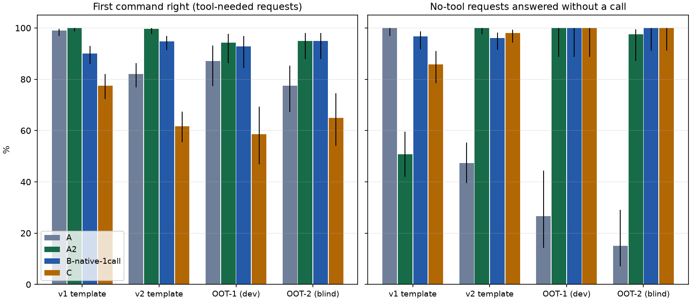

# An adapter trained on broader data matches native tool declaration on blind requests and answers no-tool requests, at an eighth of the prompt

**Final picture (adapter v2, A2).** On 120 requests written by someone else from the command descriptions alone (OOT-2, blind), A2 picks the right first command for 76 of 80 tool requests, exactly what the stock model gets with the eight commands declared natively and told to call one per turn (76/80; paired difference 0.0 points, 95% interval [-7.5, +6.2]). A2 answers 39 of 40 no-tool requests without a call (97.5%, Wilson interval [87, 100]); the v1 adapter answered 6 of 40 (15%). A2 follows the right command sequence on 71 of 80 requests against 41 of 80 for native declaration, which probes with extra calls (64 extra calls against 4), and its prompt is 174 tokens per episode against 2,178 (8.0%). So retraining on broader data fixed the over-triggering that AMENDMENT-2 found, and the adapter's remaining advantage is prompt size and fewer superfluous calls, not better selection. Two caveats: the gain does not carry to every phrasing (A2 answered only 61 of 120 no-tool requests on the v1 curriculum's own test, see below), and 80 tool requests cannot separate arms that are this close.



## Conclusions

1. **Blind test (OOT-2, 120 requests).** First command: A2 76/80 (95.0%), native-with-one-call 76/80 (95.0%), v1 adapter 62/80 (77.5%), cheat sheet 52/80 (65.0%). A2 minus native: +0.0 [-7.5, +6.2]; A2 minus v1: +17.5 [+7.5, +27.5]. No-tool specificity: A2 39/40, native 40/40 (A2 minus native -2.5 [-7.5, 0.0]), v1 6/40, cheat sheet 40/40. Neither well-formedness nor malformed JSON is an issue for A2 (93 of 93 calls well-formed, 0 malformed first turns); native declaration is 153 of 156.
2. **Specificity was a data problem, and the fix worked where it was aimed.** The v1 adapter called a command on 34 of the 40 blind no-tool requests, 31 of those calls to names outside the eight (`translate`, `rephrase`, `largest_planet`, `capital_of`, `fix_grammar`, ...); A2 made one unparseable call and native declaration none. On the development set (OOT-1) A2 went from 8/30 to 30/30.
3. **A2 is not uniformly specific.** On the v1 curriculum's test (the v1-template test, out-of-template for A2's phrasing) A2's first command is perfect (280/280) but it answered only 61 of 120 no-tool requests directly (50.8% [42, 60]). Its failures are the v1 direct tasks: 33 of 40 "repeat exactly the word fern..." requests went to `recall` or `remember`, 24 of 40 "capitalize the word fern..." requests to an invented `capitalize` or `str_case`, and 2 of 40 "reverse the characters" requests to other calls. A2's word games are phrased differently, and an odd token such as `fern20000` pulls it toward the memory commands. Native declaration got 116/120 on the same requests.
4. **In-template (v2-template test, 400 requests).** A2 249/250 first command (99.6%) against native 237/250 (94.8%), +4.8 [+2.0, +8.0]; no-tool specificity 150/150 against 144/150, +4.0 [+1.3, +7.3]. The v1 adapter, which never saw these phrasings, scores 82.0% and 47.3%. This test is built from the training shapes and says A2 learned them.
5. **Development set (OOT-1).** A2 66/70 (94.3%) and 30/30; native 65/70 and 30/30; difference +1.4 [-5.7, +8.6]. OOT-1's failures informed the v2 data, so this set is reported for continuity only.
6. **Prompt cost.** Prompt tokens per episode, A2 against native-with-one-call: 174 against 2,178 on OOT-2 (8.0%), 166 against 1,928 on the v2-template test (8.6%), 171 against 2,080 on OOT-1 (8.2%); against the cheat sheet, 19% (174 against 910 on OOT-2). These are prompt sizes, not latency or speed.
7. **What did not change.** The adapter still knows only the eight commands; the in-template numbers measure learned phrasings; one seed, one adapter per version.

## Results, adapter v2 round

Arms: **A** the v1 adapter (unchanged); **A2** the v2 adapter; **B-native-1call** stock, eight commands declared through the renderer plus the sentence "Call one command per turn."; **C** the cheat sheet. All arms get the same fixture sentence, effort 0.0, temperature 1.0, 512 completion tokens, four turns. Test sets: the v1-template test (400, the earlier in-template test), the v2-template test (400, generated by the v2 generator, held out), OOT-1 (100, development) and **OOT-2** (120, blind). Definitions of every column are those of the previous round (below); no-tool specificity is the share of no-tool requests answered cleanly with no call, with a Wilson 95% interval. Everything is rebuilt from the traces by [v4/report_v4.py](v4/report_v4.py) into [results-v4.json](runs/v4/results-v4.json).

**v1-template test** (400 requests: 280 need a command, 120 do not)

| Arm | First command right | First turn malformed | Well-formed calls | Exact sequence | Extra calls | No-tool specificity (Wilson 95%) | Prompt tok / episode |
| --- | ---: | ---: | ---: | ---: | ---: | ---: | ---: |
| A | 277/280 (98.9%) | 0 | 377/377 (100.0%) | 277/280 (98.9%) | 0 | 120/120 (100.0%) [97, 100] | 207 |
| A2 | 280/280 (100.0%) | 0 | 442/442 (100.0%) | 279/280 (99.6%) | 62 | 61/120 (50.8%) [42, 60] | 224 |
| B-native-1call | 252/280 (90.0%) | 0 | 493/499 (98.8%) | 203/280 (72.5%) | 125 | 116/120 (96.7%) [92, 99] | 2,237 |
| C | 217/280 (77.5%) | 47 | 436/462 (94.4%) | 177/280 (63.2%) | 116 | 103/120 (85.8%) [78, 91] | 1,101 |

**v2-template test (in-template for A2)** (400 requests: 250 need a command, 150 do not)

| Arm | First command right | First turn malformed | Well-formed calls | Exact sequence | Extra calls | No-tool specificity (Wilson 95%) | Prompt tok / episode |
| --- | ---: | ---: | ---: | ---: | ---: | ---: | ---: |
| A | 205/250 (82.0%) | 1 | 326/328 (99.4%) | 179/250 (71.6%) | 87 | 71/150 (47.3%) [40, 55] | 166 |
| A2 | 249/250 (99.6%) | 0 | 308/308 (100.0%) | 243/250 (97.2%) | 0 | 150/150 (100.0%) [98, 100] | 166 |
| B-native-1call | 237/250 (94.8%) | 1 | 380/381 (99.7%) | 186/250 (74.4%) | 84 | 144/150 (96.0%) [92, 98] | 1,928 |
| C | 154/250 (61.6%) | 72 | 280/320 (87.5%) | 120/250 (48.0%) | 69 | 147/150 (98.0%) [94, 99] | 873 |

**OOT-1 (development set)** (100 requests: 70 need a command, 30 do not)

| Arm | First command right | First turn malformed | Well-formed calls | Exact sequence | Extra calls | No-tool specificity (Wilson 95%) | Prompt tok / episode |
| --- | ---: | ---: | ---: | ---: | ---: | ---: | ---: |
| A | 61/70 (87.1%) | 0 | 98/98 (100.0%) | 55/70 (78.6%) | 27 | 8/30 (26.7%) [14, 44] | 184 |
| A2 | 66/70 (94.3%) | 0 | 83/84 (98.8%) | 65/70 (92.9%) | 2 | 30/30 (100.0%) [89, 100] | 171 |
| B-native-1call | 65/70 (92.9%) | 0 | 112/112 (100.0%) | 50/70 (71.4%) | 27 | 30/30 (100.0%) [89, 100] | 2,080 |
| C | 41/70 (58.6%) | 20 | 83/96 (86.5%) | 30/70 (42.9%) | 29 | 30/30 (100.0%) [89, 100] | 919 |

**OOT-2 (blind)** (120 requests: 80 need a command, 40 do not)

| Arm | First command right | First turn malformed | Well-formed calls | Exact sequence | Extra calls | No-tool specificity (Wilson 95%) | Prompt tok / episode |
| --- | ---: | ---: | ---: | ---: | ---: | ---: | ---: |
| A | 62/80 (77.5%) | 0 | 119/119 (100.0%) | 55/80 (68.8%) | 51 | 6/40 (15.0%) [7, 29] | 194 |
| A2 | 76/80 (95.0%) | 0 | 93/93 (100.0%) | 71/80 (88.8%) | 4 | 39/40 (97.5%) [87, 100] | 174 |
| B-native-1call | 76/80 (95.0%) | 0 | 153/156 (98.1%) | 41/80 (51.2%) | 64 | 40/40 (100.0%) [91, 100] | 2,178 |
| C | 52/80 (65.0%) | 25 | 103/111 (92.8%) | 32/80 (40.0%) | 44 | 40/40 (100.0%) [91, 100] | 910 |

**Paired bootstrap** (10,000 draws, seed 0, percentile 2.5 / 97.5; points)

| Test | Comparison | First command | No-tool specificity |
| --- | --- | ---: | ---: |
| v1-template test | A2-B-native-1call | +10.0 [+6.4, +13.6] (n=280) | -45.8 [-55.0, -35.8] (n=120) |
| v1-template test | A2-A | +1.1 [+0.0, +2.5] (n=280) | -49.2 [-58.3, -40.0] (n=120) |
| v2-template test (in-template for A2) | A2-B-native-1call | +4.8 [+2.0, +8.0] (n=250) | +4.0 [+1.3, +7.3] (n=150) |
| v2-template test (in-template for A2) | A2-A | +17.6 [+12.8, +22.4] (n=250) | +52.7 [+44.7, +60.7] (n=150) |
| OOT-1 (development set) | A2-B-native-1call | +1.4 [-5.7, +8.6] (n=70) | +0.0 [+0.0, +0.0] (n=30) |
| OOT-1 (development set) | A2-A | +7.1 [+0.0, +14.3] (n=70) | +73.3 [+56.7, +86.7] (n=30) |
| OOT-2 (blind) | A2-B-native-1call | +0.0 [-7.5, +6.2] (n=80) | -2.5 [-7.5, +0.0] (n=40) |
| OOT-2 (blind) | A2-A | +17.5 [+7.5, +27.5] (n=80) | +82.5 [+67.5, +95.0] (n=40) |

**Invented command names** (calls to names outside the eight; count of calls)

| Test | Arm | Calls | Names |
| --- | --- | ---: | --- |
| v1-template test | A | 0 | none |
| v1-template test | A2 | 24 | `capitalize` x20, `str_case` x3, `reverse` x1 |
| v1-template test | B-native-1call | 0 | none |
| v1-template test | C | 21 | `-h` x16, `bash` x3, `read` x1, `help` x1 |
| v2-template test (in-template for A2) | A | 43 | `translate` x8, `dictionary` x4, `rephrase` x4, `reword` x3, `define` x2, `explain` x2, `INVALID` x2, `brainstorm_ideas` x1, `smallest_prime` x1, `prime` x1, `suggest_hobby` x1, `explain_vaccines` x1, `count_vowels` x1, `ask_user` x1, `hasty` x1, `most_moons_planet` x1, `abbreviate` x1, `welcome_new_neighbors` x1, `explain_word` x1, `web` x1, `lookup` x1, `which_planet_has_most_moons` x1, `sort_letters` x1, `rewrite` x1, `Kyoto` x1 |
| v2-template test (in-template for A2) | A2 | 0 | none |
| v2-template test (in-template for A2) | B-native-1call | 0 | none |
| v2-template test (in-template for A2) | C | 20 | `-h` x15, `bash` x3, `help` x2 |
| OOT-1 (development set) | A | 15 | `INVALID` x1, `update_event` x1, `image_gen_caption` x1, `poem` x1, `synonyms` x1, `primary_colors` x1, `rhymes` x1, `who_wrote` x1, `days_in_leap_year` x1, `sign_off` x1, `up_planet_at_distance` x1, `rewrite` x1, `translate` x1, `plural` x1, `nickname` x1 |
| OOT-1 (development set) | A2 | 1 | `INVALID` x1 |
| OOT-1 (development set) | B-native-1call | 0 | none |
| OOT-1 (development set) | C | 5 | `-h` x4, `help` x1 |
| OOT-2 (blind) | A | 31 | `translate` x5, `INVALID` x5, `largest_planet` x1, `mortgage_rates` x1, `fix_grammar` x1, `rephrase` x1, `refrigerator` x1, `name_ideas` x1, `(287000` x1, `suggest_names` x1, `rewrite` x1, `3` x1, `language_of` x1, `unclutter` x1, `reduce_monday_stress` x1, `read_text_file` x1, `capital_of` x1, `suggest_date_ideas` x1, `1284` x1, `show_model_demand` x1, `nfl_snap_check_clinch` x1, `hours` x1, `dream` x1 |
| OOT-2 (blind) | A2 | 1 | `INVALID` x1 |
| OOT-2 (blind) | B-native-1call | 0 | none |
| OOT-2 (blind) | C | 1 | `-h` x1 |

## How this round was run

Pre-registered in [AMENDMENT-3.md](AMENDMENT-3.md): the blind set was written by another author and was not opened until the v2 data had been generated, hashed and committed (commit `d2476f3a`). Opening it showed 32 shared content three-grams and 6 near-duplicate requests (among them trivia questions we had written independently, such as the language spoken in Brazil); the overlapping training items were removed and replaced, using the blind file only as a filter, and the data was re-committed (`08122f42`) before any training. A2 was trained from the recipe at `60cb705` with v1's settings (rank 32, batch 32, one epoch, default learning rate, effort 0.0, seed 0; validation first-command accuracy 99.6% and no-tool specificity 98.7% at step 100). A v2-template test set was added in Addendum 2 before sampling (`5bd339fd`). The evaluation ran from commit `5bd339fd` with the runner refusing a dirty `v3/` or `v4/`; the first launch exited before any sampling because an untracked log sat in `v4/data`, and I moved it out and relaunched. [Provenance](runs/v4/provenance.json) records commits, file hashes, data and test hashes. Units: `inkling-tinker-tools-a2-data` through `-data6` (answers), `-a2-train`, `-a2-eval`.

**What the v2 data is.** 4,000 train and 400 validation conversations like v1's size, with 1,540 single commands built from 14 to 18 independent sentence shapes per command, 400 two-step chains, 320 help-first or unsupported-flag requests, 240 follow-ups about a shown result, and about 1,700 no-tool turns of many kinds (definitions, translation, rewording, small talk, opinions, explanations, brainstorming, trivia, mental arithmetic, word games, questions about the tools). 1,100 of the no-tool answers were sampled from the stock model (so A2's no-tool answers mimic it, errors included); the rest are computed. Near-miss pairs: small sums answered directly against long exact products sent to `calc`, and concept questions ("what is a URL") against requests to use the command.

## The shipped recipe, run end to end (pr-live)

The upstream-bound recipe (`recipe-trained-tools-pr`, code commit `e6661f6`, final commit `31255c2`) was run exactly as its README says, from a clean copy: its own generator, trainer and evaluator, then the three arms on its generated test and on the blind file ([provenance](runs/pr-live/final/provenance.json), [summary](runs/pr-live/final/summary.json), traces in [runs/pr-live/final](runs/pr-live/final/)). Its README table was these numbers until the pre-submission round below, which rescored them and added blind v1.1. Its data is not the study's data: the generator is the same design but draws differently, re-samples the no-tool answers and filters only against the blind file.

| Blind test (80 tool / 40 no-tool) | First command | No-tool specificity | Extra calls | Prompt tok / episode |
| --- | ---: | ---: | ---: | ---: |
| Study adapter A2 | 76/80 | 39/40 | 4 | 174 |
| Shipped recipe, first run | 73/80 | 40/40 | 6 | 174 |
| Shipped recipe, final run | 73/80 | 34/40 | 13 | 181 |
| Native declaration (final run) | 76/80 | 40/40 | 48 | 2,075 |

First command is within 4 points of the study in both runs of the shipped recipe. The blind no-tool rate is not: 34/40 in the final run against 39/40 in the study, 12.5 points lower. Two runs of the same shipped code gave 40/40 and 34/40, so run-to-run variation (the stock-model answers are re-sampled and training is stochastic) spans the gap; I made no code change on that account. The six calls in the final run were `ask_model` on an explanation, a name brainstorm and small talk, `calc` on two word problems and one invented `capital_lookup`. In the final run adapter minus native on the blind test is -3.8 points on first command [-11.3, +5.0] and -15.0 on no-tool specificity [-27.5, -5.0]; on the generated test they are +2.0 [-1.2, +5.6] and -0.7 [-6.0, +4.0]. Read the blind no-tool rate for this recipe as roughly 85 to 100%, not as a stable 97.5%.

The live run found three things the replayed tests could not: the account's checkpoint storage filled with the intermediate saves (a first end-to-end attempt died at step 107 with "Free checkpoint storage limit reached"), so `save_every` now defaults to 0 (final checkpoint only); `sample_async` and `create_sampling_client_async` are deprecated in the installed SDK, so the recipe uses `sample` and `create_sampling_client`; and `prepare` had no estimate before spending and no cost report afterwards, so it now has `--dry-run` and prints the list price of the answers it sampled. Two evaluations on different files also overwrote each other's `comparison.json`; the file name now carries the test file's name. Spend: [COST.md](COST.md).

## Pre-submission review round (REVIEW-tools-pr.md)

The review reproduced every number and asked for three fixes, then a set of smaller ones. Done: the sheet arm now declares one `bash` tool through the renderer (M1); follow-up rows expect only the commands their first request needs, with a test, and the saved adapter and native traces were rescored offline (M2: exact sequence 238 to 243 and 194 to 198 in the final run); the README shows both runs per cell (M3); "Well-formed" became "Parsed calls" with invented-name and parallel-call counts for every arm (S1); the paired bootstrap ships in `eval.py` with a test (S2); the family and group checks that could never fire are gone and the README says the generated test reuses the training templates (S3); `prepare` prints its estimate first, takes `--budget-usd` and appends answers as they arrive (S4); `prepare.py` has a `Row` dataclass and no `type: ignore` or `fmt: skip` (S5, output hash identical to the old generator); the launcher's estimate and `budget_usd` include validation (S6, partly); negative calc results, the system-prompt clause, "uncached" and `uv run` (m3, m6, m7, m8). Not done: a pure-Python backend (m2), default output paths (m4), moving the phrase pools to a data file (m5), a smoke test (m9).

M1 did not remove the sheet arm's plain-text failure: with `bash` declared, first-turn malformed was still 57 and 45 of 250 on the generated test and 19 and 22 of 80 on the blind test, and in 55 of 57, 44 of 45, 18 of 19 and 21 of 22 the visible text named the expected command first. The cheat sheet shows `name "argument"`, and the model writes exactly that. First command went from 169 to 180 (final run). The README reports the column and says so. S6 could not be met as asked: the trainer evaluates before each update, so with 125 updates `eval_every=25` still stops at step 100; the README says `eval` on the test split is the final-weights check.

**Blind file v1.1.** `tools-blind/oot2-v1.1.jsonl` (sha256 `8debdb54…`) is v1 with 23 mechanical substitutions (see `tools-blind/README.md`) and nothing else, committed before it was applied and before any v1.1 sampling; v1 stays in the folder. The recipe's curriculum is identical whether it excludes v1 or v1.1 (the request list hashes equal). The blind numbers in the README are two fresh samplings of all three arms on v1.1 with the final adapter, no retraining ([runs/pr-round4](runs/pr-round4/), [summary.json](runs/pr-round4/summary.json)).

| Blind v1.1 (80 tool / 40 no-tool) | First command | No-tool | Extra calls | Prompt tok / episode |
| --- | ---: | ---: | ---: | ---: |
| Adapter, two samplings | 71 and 70 | 36 and 35 | 11 and 10 | 176 and 172 |
| Native, two samplings | 77 and 78 | 39 and 39 | 65 and 48 | 2,224 and 2,107 |
| Sheet (declared `bash`), two samplings | 55 and 54 | 39 and 40 | 45 and 49 | 764 and 740 |

Adapter minus native on first command: -7.5 [-15.0, 0.0] and -10.0 [-18.8, -2.5]. On the original v1 file the same adapter was -3.8 [-11.3, +5.0], and the study's A2 tied native at 76/80. The v1.1 numbers are lower for the adapter and about equal for native, and the two samplings differ by a point or two; the substitution changed names of places and sites, which the adapter had never seen either way, so I read the gap as run-to-run variation plus a harder-than-first-thought file, not as an effect of the table, but one adapter cannot separate them. Generated test (adapter and native rescored, sheet re-sampled), run 1 / run 2: adapter 249 / 243 first command, native 238 / 238, sheet 197 / 180; adapter minus native +4.4 [+1.6, +7.2] and +2.0 [-1.2, +5.6]. The two runs' test requests differ in 20 of 400.

Final PR commit `4c19f92` on upstream `8bf7dd6`, 2,231 added lines in 14 files. The PR text is [PR-DESCRIPTION.md](PR-DESCRIPTION.md).

## Limits

One adapter per version, one seed, one sample per request. OOT-2 has 80 tool and 40 no-tool requests, so intervals on first command are about 7 points wide each way. The mental-arithmetic boundary (small sums mentally, long products with `calc`) is a design choice; a blind author could draw the line elsewhere (for example sending "15 times 4" to `calc`), which would count against A2. Training answers were sampled from the stock model, so they carry its mistakes and style. The v2 data was built after seeing OOT-1's failures and filtered against both test sets, which makes OOT-2 harder, not easier, but it was authored by the same person who saw OOT-1. The remaining failure on the v1-template test shows that specificity depends on phrasing.

## Reproduction

Data, generator, runner and report are in [v4/](v4/); AMENDMENT-3 lists the hashes. `python v4/gen_v2.py plan|assemble ... --exclude <held-out files>` rebuilds the data (answers are read from `v4/data/answers.jsonl` and `answers_test.jsonl`); `python v4/run_v4.py --dry-run ...` prints the estimate; sampling and training run as `systemd-run --user` units with the key in the unit's environment; `python v4/report_v4.py runs/v4` rebuilds the tables and chart. Run `v4/test_v4.py` from the recipe snapshot directory (see the previous round's note).

---

# Previous round (AMENDMENT-2): v1 adapter against native tool declaration

**What the adapter buys.** Against the stock model with the eight commands declared natively through the renderer, the LoRA adapter uses about a tenth of the prompt tokens (207 against 2,046 per episode in-template) and writes a valid call every time. On the in-template test it picks the right first command more often (278/280 against 238/280), but that test is built from the training phrases. On 100 hand-written requests with phrasing it never saw, the first-command difference is +2.9 points with a 95% interval of [-7.1, +12.9]: no measurable edge. On the same requests the adapter invented a command for 23 of 30 no-tool questions, where every stock arm answered directly. The gap closes with native tool declaration; what remains is cost per prompt, not better selection.

These numbers replace the headline of the earlier write-up (3.58% of the schema arm's prompt tokens; 279/280 against 208/280). That comparison put JSON schemas into system text, repeated one 90-word paragraph in all eight of them, and counted garbled call JSON as a wrong command.


### Conclusions of that round

1. **First command and well-formedness are separate facts.** First command right is whether the first parsed call names the expected command. Well-formed calls is parsed calls over call attempts. In the earlier run 29 of the stock schema arm's 33 first-command misses were malformed call JSON (for example `{"name"""bash"`), and 28 of those 29 had reached for the right command (heuristic below). Declaring the tools through the renderer removes that failure: native declaration produced 0 malformed turns in 463 call attempts in-template and 0 in 104 out-of-template. System-text schemas still produce them: 75 malformed turns for B-lean in-template and 48 for the cheat sheet.
2. **In-template, the adapter still leads, by less.** First command: adapter 278/280 (99.3%), native 238/280 (85.0%), native with one added sentence asking for one call per turn 258/280 (92.1%), cheat sheet 211/280 (75.4%), lean schemas in system text 192/280 (68.6%). Adapter minus native is +14.29 points [+10.00, +18.57]; adapter minus native-with-one-call is +7.14 [+3.93, +10.71]. Part of native's deficit is the harness: 21 native first turns issued several calls at once, which the loop rejects; read by their first call those turns lift native to 245/280 (87.5%).
3. **Out-of-template, the gap closes.** First command: adapter 63/70 (90.0%), native 61/70 (87.1%), native with one call per turn 65/70 (92.9%), cheat sheet 45/70 (64.3%). Adapter minus native is +2.86 [-7.14, +12.86]; adapter minus native-with-one-call is -2.86 [-12.86, +7.14]. Seventy tool-needed requests cannot separate arms this close.
4. **The adapter over-triggers on unfamiliar no-tool requests.** No-tool specificity out-of-template: adapter 7/30 (23.3%); native, native with one call and the cheat sheet 30/30. The adapter called `translate`, `synonym`, `antonyms`, `closest_planet` and similar commands that do not exist, or `ask_model` and `recall` on factual questions. In-template its specificity is 120/120, because the training no-tool requests are three templated word tasks. Exact sequences out-of-template: adapter 57/70 (81.4%), native 48/70 (68.6%), native with one call 53/70 (75.7%), cheat sheet 33/70 (47.1%).
5. **Token ratio depends on the comparator.** Total prompt tokens, adapter over each arm, in-template: native 10.1%, native with one call 9.3%, lean schemas 5.2%, cheat sheet 18.6%; out-of-template: native 9.7%, cheat sheet 20.3%. The earlier 3.58% was against the padded schema (2,812 first-turn tokens, against 903 for the native declaration and 1,996 for the same text form with the paragraph removed). These are prompt-size figures, not latency or speed claims.
6. **The in-template test is in-template.** It uses the training curriculum's sixteen intent phrases with new wrappers and numbers; 99.3% there measures recall of a learned pattern. The out-of-template set changes verbs, sentence shapes and argument style together, so it cannot say which of the three the adapter is sensitive to.

### v3 results

Arms: **A** the unchanged adapter (no tool text); **B-native** stock with the eight commands declared through the renderer's tool path (one-line description, one text argument, no bash transport); **B-lean** the earlier schema-in-system-text form with only the repeated paragraph removed (it still repeats a per-argument description and uses indented JSON, so it is not minimal); **C** the earlier cheat-sheet arm; **B-native-1call** B-native plus the sentence `Call one command per turn.`, added after the first run (see below). All share the same fixture sentence, effort 0.0, temperature 1.0, 512 completion tokens, four turns. Definitions, the out-of-template set and the registered analysis are in [AMENDMENT-2.md](AMENDMENT-2.md); every number below is rebuilt from the traces by [v3/report_v3.py](v3/report_v3.py) into [results-v3.json](runs/v3/results-v3.json).

"First turn malformed" counts tool-needed episodes whose first turn the renderer could not parse; the bracket is how many of those named the expected command by a heuristic (the first of the eight command names after the call marker in the raw text), which is descriptive and not part of any accuracy figure. Well-formed calls are parsed calls over call attempts. Exact sequence needs the expected command names in order and a clean final answer; it does not match answer text. Extra calls are calls beyond an ordered match to the expected names, over all episodes.

**In-template test (400 episodes: 280 need a tool, 120 do not)**

| Arm | First command right | First turn malformed (intended command right) | Well-formed calls | Exact sequence | Extra calls | No-tool specificity | Prompt tok / episode | Completion tok / episode |
| --- | ---: | ---: | ---: | ---: | ---: | ---: | ---: | ---: |
| A | 278/280 (99.3%) | 0 (0) | 378/378 (100.0%) | 278/280 (99.3%) | 0 | 120/120 (100.0%) | 207 | 50 |
| B-native | 238/280 (85.0%) | 0 (0) | 423/463 (91.4%) | 181/280 (64.6%) | 91 | 118/120 (98.3%) | 2,046 | 237 |
| B-lean | 192/280 (68.6%) | 75 (65) | 371/456 (81.4%) | 144/280 (51.4%) | 105 | 113/120 (94.2%) | 3,956 | 208 |
| C | 211/280 (75.4%) | 46 (22) | 434/461 (94.1%) | 174/280 (62.1%) | 112 | 109/120 (90.8%) | 1,112 | 259 |
| B-native-1call | 258/280 (92.1%) | 0 (0) | 480/487 (98.6%) | 206/280 (73.6%) | 111 | 120/120 (100.0%) | 2,222 | 253 |

**Out-of-template test (100 episodes: 70 need a tool, 30 do not)**

| Arm | First command right | First turn malformed (intended command right) | Well-formed calls | Exact sequence | Extra calls | No-tool specificity | Prompt tok / episode | Completion tok / episode |
| --- | ---: | ---: | ---: | ---: | ---: | ---: | ---: | ---: |
| A | 63/70 (90.0%) | 0 (0) | 101/101 (100.0%) | 57/70 (81.4%) | 28 | 7/30 (23.3%) | 187 | 53 |
| B-native | 61/70 (87.1%) | 0 (0) | 102/104 (98.1%) | 48/70 (68.6%) | 28 | 30/30 (100.0%) | 1,930 | 200 |
| C | 45/70 (64.3%) | 19 (4) | 85/90 (94.4%) | 33/70 (47.1%) | 26 | 30/30 (100.0%) | 921 | 202 |
| B-native-1call | 65/70 (92.9%) | 0 (0) | 105/105 (100.0%) | 53/70 (75.7%) | 24 | 30/30 (100.0%) | 2,000 | 214 |

**Paired bootstrap, first command, A minus B-native** (tool-needed episodes, 10,000 draws, seed 0, percentile 2.5 / 97.5)

| Test | A minus comparator (points) | 95% interval | n |
| --- | ---: | ---: | ---: |
| In-template | +14.29 | [+10.00, +18.57] | 280 |
| Out-of-template | +2.86 | [-7.14, +12.86] | 70 |
| In-template, vs B-native-1call (follow-up) | +7.14 | [+3.93, +10.71] | 280 |
| Out-of-template, vs B-native-1call (follow-up) | -2.86 | [-12.86, +7.14] | 70 |

**Multi-call first turns** (tool-needed episodes; the harness accepts one call per turn)

| Test | Arm | First turn issued several calls | First command right if such a turn is read by its first call |
| --- | --- | ---: | ---: |
| in | A | 0 | 278/280 (99.3%) |
| in | B-native | 21 | 245/280 (87.5%) |
| in | B-lean | 3 | 193/280 (68.9%) |
| in | C | 0 | 211/280 (75.4%) |
| in | B-native-1call | 2 | 258/280 (92.1%) |
| ood | A | 0 | 63/70 (90.0%) |
| ood | B-native | 2 | 62/70 (88.6%) |
| ood | C | 0 | 45/70 (64.3%) |
| ood | B-native-1call | 0 | 65/70 (92.9%) |

**Prompt-token ratio, A over each arm** (total prompt tokens over the whole test)

| Test | vs B-native | vs B-lean | vs C |
| --- | ---: | ---: | ---: |
| In-template | 10.1% | 5.2% | 18.6% |
| Out-of-template | 9.7% | not run | 20.3% |

**How the run was made.** The first run (`runs/v3`, arms A, B-native, B-lean, C) sampled after AMENDMENT-2, the evaluation code and the 100 requests were committed (research repository commit `dfca642b`; recipe snapshot `08876d4` extracted into a frozen directory). Its traces showed B-native issuing parallel calls, so an addendum to AMENDMENT-2 added one follow-up arm, B-native-1call, and was committed (`01c80fba`) before that arm was sampled (`runs/v3b`). The follow-up is post hoc and is reported next to B-native, not instead of it. Each run's [provenance.json](runs/v3/provenance.json) records the repository commit, the file hashes, both test-file hashes and the package versions, and the runner refuses to start with uncommitted changes under `v3/`. The v3 sampling units were `inkling-tinker-tools-v3` and `inkling-tinker-tools-v3b`; spend is in [COST.md](COST.md).

### Limits

One adapter, one training seed, one sample per request, one model. Intervals resample episodes, not training or sampling seeds. The out-of-template set is 100 requests written once by one author; its 70 tool-needed episodes give wide intervals. B-native's schema (descriptions, a shared argument note that mentions `-h`) was written once and not tuned; a different note could move it. The fake backend tests command selection and call syntax, not search relevance, image quality, URL safety or open-ended reasoning. Strict sequence scoring rewards the curriculum's conventions (for example reading a page after finding it, or recalling from an empty memory), which is why exact sequence is secondary to first command. No latency, energy or general-ability claim is made.

### Reproduction

Arm prompts, the out-of-template requests, the scorer and the report are in [v3/](v3/); the cookbook recipe the evaluation imports is the `recipe-trained-tools` branch (commit `08876d4`). The sampling command spends money; a dry run first prints the estimate and refuses to start above the budget.

```bash
# frozen copy of the recipe, then the dry run (no key, no service client)
git -C <cookbook-checkout> archive recipe-trained-tools | tar -x -C <snapshot-dir>
git -C <cookbook-checkout> rev-parse recipe-trained-tools > <snapshot-dir>/COMMIT
PYTHONPATH=<snapshot-dir>:v3 python v3/run_v3.py --dry-run --test <data-dir>/test.jsonl \
  --ood v3/data/ood.jsonl --checkpoints runs/main/checkpoints.jsonl --snapshot <snapshot-dir> --out <out-dir>
# sampling: put the key in the environment of a user unit (never on the command line)
systemd-run --user --unit=<unit> --setenv=TINKER_API_KEY --setenv=PYTHONPATH=<snapshot-dir>:v3 \
  python v3/run_v3.py ...same arguments without --dry-run...
python v3/report_v3.py runs/v3 runs/v3b     # tables, JSON and chart from the saved traces
```

Run the unit tests from the snapshot directory (`cd <snapshot-dir>`), because the cookbook checkout's own tree can shadow it on `sys.path`.

### History: earlier runs (kept as recorded)

The two earlier evaluations are unchanged. The main run followed [PREREG.md](PREREG.md); the v2 rerun followed [AMENDMENT-1.md](AMENDMENT-1.md), which was committed before v2 sampling. The v2 evaluation code itself was committed about three minutes **after** v2 sampling finished (sampling ended 05:09:48, the recipe commit `08876d4` is timestamped 05:12:36); no code snapshot was saved for v2, and v2 has no provenance file. An independent review checked that every v2 arm prompt in the traces equals what that commit renders and that its scores equal an independent recompute. The v3 runs above do not have this gap.

The reasoning behind the revision above: in v2, arm B put JSON schemas into system text rather than declaring tools through the renderer. 29 of B's 33 first-command misses were malformed first turns (heuristically, 28 of them naming the right command; the review counted 27 by hand), 48 of the cheat-sheet arm's 61. The 3.58% token ratio below compared the adapter with B's 2,318,037 prompt tokens; against the same-run cheat-sheet arm the adapter used 18.9%, and against C0 35.7%.

### Pre-registered main-run table (unchanged)

Strict tool accuracy requires a clean completion and exact full command-name sequence on 280 tool-needed episodes. Valid execution is successful executions per parsed call. No-tool precision is correct direct requests per clean no-call prediction; no-tool specificity is clean no-call predictions per 120 direct requests. Reference final accuracy is whitespace-normalized exact match to the original target over all 400 episodes. Episode accuracy additionally requires the expected sequence and valid executions.

| Arm | Strict tool accuracy | Valid execution | No-tool precision | No-tool specificity | Reference final accuracy | Episode accuracy |
| --- | --- | --- | --- | --- | --- | --- |
| A | 279/280 (99.64%) | 379/379 (100.00%) | 120/120 (100.00%) | 120/120 (100.00%) | 393/400 (98.25%) | 393/400 (98.25%) |
| B | 173/280 (61.79%) | 437/440 (99.32%) | 117/117 (100.00%) | 117/120 (97.50%) | 150/400 (37.50%) | 148/400 (37.00%) |
| C | 16/280 (5.71%) | 47/102 (46.08%) | 111/113 (98.23%) | 111/120 (92.50%) | 99/400 (24.75%) | 95/400 (23.75%) |

[Original analysis](runs/v2/main-analysis.json): A minus B strict accuracy is 37.86 percentage points, with a paired 95% interval [32.14, 43.57]. The numerical registered success gates pass, but the baseline defects limit that result's interpretation. This table is not retroactively rescored.

### Post hoc amendment table

First command accuracy counts a correct first parsed command even if later steps fail. Ordered containment means all reference command names occur in order among parsed calls. Extra calls are parsed calls not consumed by a greedy ordered reference match, including wrong commands and calls on direct requests; the mean uses all 400 episodes. Selection diagnostics do not require a clean final completion. Actual-result final accuracy compares the final answer to the last successful result the model received, retaining the direct-answer and unsupported-flag targets. It measures faithful reporting separately from task success and can pass a wrong tool or rewritten argument. Mapped calls count stock native calls converted by the parser.

| Arm | Strict tool accuracy | First command | Ordered containment | Extra calls / episode | Actual-result final accuracy | Mapped calls |
| --- | --- | --- | --- | --- | --- | --- |
| A | 279/280 (99.64%) | 279/280 (99.64%) | 279/280 (99.64%) | 0/400 = 0.000 | 390/400 (97.50%) | 0 |
| B | 208/280 (74.29%) | 247/280 (88.21%) | 250/280 (89.29%) | 54/400 = 0.135 | 149/400 (37.25%) | 11 |
| C | 172/280 (61.43%) | 219/280 (78.21%) | 229/280 (81.79%) | 110/400 = 0.275 | 150/400 (37.50%) | 88 |
| C0 | 132/280 (47.14%) | 163/280 (58.21%) | 172/280 (61.43%) | 116/400 = 0.290 | 131/400 (32.75%) | 240 |

All arms saw the same 400 requests: 280 tool-needed and 120 direct. The bash-only parser remains for A. For stock arms, exactly one known native function with one nonempty text argument is mapped; ambiguous/multiple calls and malformed arguments still fail. Retain the other original metrics for transparency:

| Arm | Valid execution | No-tool precision | No-tool specificity | Reference final accuracy | Episode accuracy |
| --- | --- | --- | --- | --- | --- |
| A | 379/379 (100.00%) | 120/121 (99.17%) | 120/120 (100.00%) | 390/400 (97.50%) | 390/400 (97.50%) |
| B | 401/402 (99.75%) | 113/114 (99.12%) | 113/120 (94.17%) | 146/400 (36.50%) | 141/400 (35.25%) |
| C | 404/432 (93.52%) | 112/112 (100.00%) | 112/120 (93.33%) | 146/400 (36.50%) | 137/400 (34.25%) |
| C0 | 290/343 (84.55%) | 106/107 (99.07%) | 106/120 (88.33%) | 123/400 (30.75%) | 120/400 (30.00%) |

The stock final-answer scores remain low after grading against received results (B 149/400 rather than 146/400 against references). Exact output matching penalizes explanations and natural paraphrases; this is not a semantic answer-quality metric. C0's 240 mapped calls show the transport issue mattered. Its first parsed command score still excludes prose that cannot be mapped and should not be confused with the earlier manual intended-command audit (85.7%). The shared fixture sentence reduced one source of distrust but does not prove the synthetic content is on-topic or all distrust is eliminated. No further tuning or rerun followed these outcomes.

Paired intervals resample the same 280 tool-needed episode IDs, 10,000 draws, seed 0; the random generator resets for each metric. Differences and two-sided percentile 95% intervals below are in percentage points. They describe this post hoc evaluation, not a new registered success test.

| Metric | A minus B (points) | Paired 95% interval (points) |
| --- | --- | --- |
| Strict sequence | 25.36 | [20.36, 30.71] |
| First command | 11.43 | [7.86, 15.36] |
| Ordered containment | 10.36 | [6.79, 13.93] |

### Exact token accounting and spend

Prompt tokens are the rendered input on every actual inference turn, including repeated history. Completion tokens include the model's generated thinking, calls and final answers. Counts below are measured, not character estimates. Costs use actual token counts at $0.15 per million uncached prompt tokens and $0.50 per million completion tokens, verified 2026-11-25 against the [published pricing table](https://tinker-docs.thinkingmachines.ai/tinker/models/models_and_pricing/). No cache discount is assumed.

| Run | Arm | Prompt tokens | Completion tokens | Turns | List-price token cost |
| --- | --- | --- | --- | --- | --- |
| Main | A | 72,789 | 19,979 | 779 | $0.02090785 |
| Main | B | 2,402,941 | 92,663 | 829 | $0.40677265 |
| Main | C | 128,009 | 72,087 | 491 | $0.05524485 |
| Amended v2 | A | 82,990 | 19,978 | 779 | $0.02243750 |
| Amended v2 | B | 2,318,037 | 83,030 | 799 | $0.38922055 |
| Amended v2 | C | 439,329 | 99,507 | 815 | $0.11565285 |
| Amended v2 | C0 | 232,227 | 96,058 | 724 | $0.08286305 |

Amended sampling cost **$0.61017395** from actual tokens, under the $10 budget and $5.57056 worst-case compute ceiling. Main test sampling cost **$0.48292535** at the same uncached list prices. These are token-accounted charges, not a provider invoice; actual cash billing/cache discounts and checkpoint storage charges are unavailable. No new training occurred. See [COST.md](COST.md). The four-arm unit exited successfully; no paid retry or partial rerun occurred.


### Behavior cohorts

Counts are descriptive, with no subgroup selection. Help includes help-before-operation requests; unsupported means a request to check help and decline the unsupported --turbo flag. The 60 web_search+read_url tasks use a combination withheld from training and validation. All other command compositions were known. Final counts here use actual-result grading.

| Arm | Cohort | Episodes | Strict correct | First correct | Contained | Final correct |
| --- | --- | --- | --- | --- | --- | --- |
| A | ask_model | 20 | 20 | 20 | 20 | 20 |
| A | calc | 20 | 19 | 19 | 19 | 19 |
| A | help | 40 | 40 | 40 | 40 | 40 |
| A | image_gen | 20 | 20 | 20 | 20 | 20 |
| A | image_search | 20 | 20 | 20 | 20 | 20 |
| A | read_url | 20 | 20 | 20 | 20 | 20 |
| A | recall | 20 | 20 | 20 | 20 | 20 |
| A | remember | 20 | 20 | 20 | 20 | 20 |
| A | unsupported | 20 | 20 | 20 | 20 | 20 |
| A | web_search | 20 | 20 | 20 | 20 | 20 |
| A | web_search+read_url | 60 | 60 | 60 | 60 | 60 |
| B | ask_model | 20 | 14 | 14 | 14 | 0 |
| B | calc | 20 | 16 | 16 | 16 | 8 |
| B | help | 40 | 33 | 38 | 38 | 7 |
| B | image_gen | 20 | 14 | 14 | 17 | 6 |
| B | image_search | 20 | 18 | 19 | 19 | 8 |
| B | read_url | 20 | 18 | 18 | 18 | 0 |
| B | recall | 20 | 5 | 19 | 19 | 0 |
| B | remember | 20 | 15 | 15 | 15 | 15 |
| B | unsupported | 20 | 9 | 16 | 16 | 0 |
| B | web_search | 20 | 6 | 18 | 18 | 3 |
| B | web_search+read_url | 60 | 60 | 60 | 60 | 0 |
| C | ask_model | 20 | 11 | 18 | 18 | 0 |
| C | calc | 20 | 13 | 13 | 13 | 10 |
| C | help | 40 | 32 | 36 | 37 | 16 |
| C | image_gen | 20 | 8 | 10 | 14 | 7 |
| C | image_search | 20 | 3 | 3 | 6 | 4 |
| C | read_url | 20 | 11 | 13 | 15 | 3 |
| C | recall | 20 | 14 | 19 | 19 | 0 |
| C | remember | 20 | 15 | 16 | 16 | 15 |
| C | unsupported | 20 | 13 | 18 | 18 | 0 |
| C | web_search | 20 | 0 | 18 | 18 | 2 |
| C | web_search+read_url | 60 | 52 | 55 | 55 | 0 |
| C0 | ask_model | 20 | 11 | 13 | 13 | 0 |
| C0 | calc | 20 | 2 | 2 | 2 | 2 |
| C0 | help | 40 | 24 | 28 | 28 | 16 |
| C0 | image_gen | 20 | 7 | 7 | 11 | 9 |
| C0 | image_search | 20 | 5 | 6 | 11 | 5 |
| C0 | read_url | 20 | 18 | 18 | 18 | 2 |
| C0 | recall | 20 | 12 | 18 | 18 | 0 |
| C0 | remember | 20 | 17 | 17 | 17 | 14 |
| C0 | unsupported | 20 | 11 | 18 | 18 | 0 |
| C0 | web_search | 20 | 1 | 10 | 10 | 0 |
| C0 | web_search+read_url | 60 | 24 | 26 | 26 | 0 |

